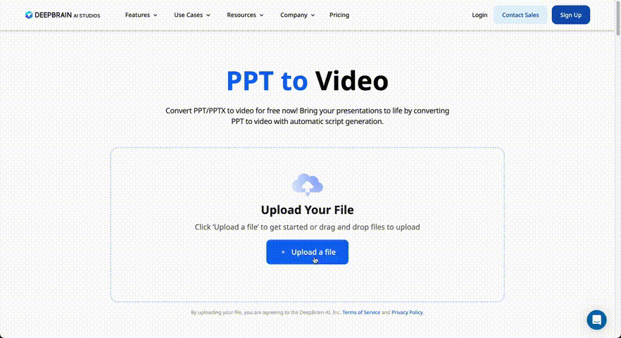
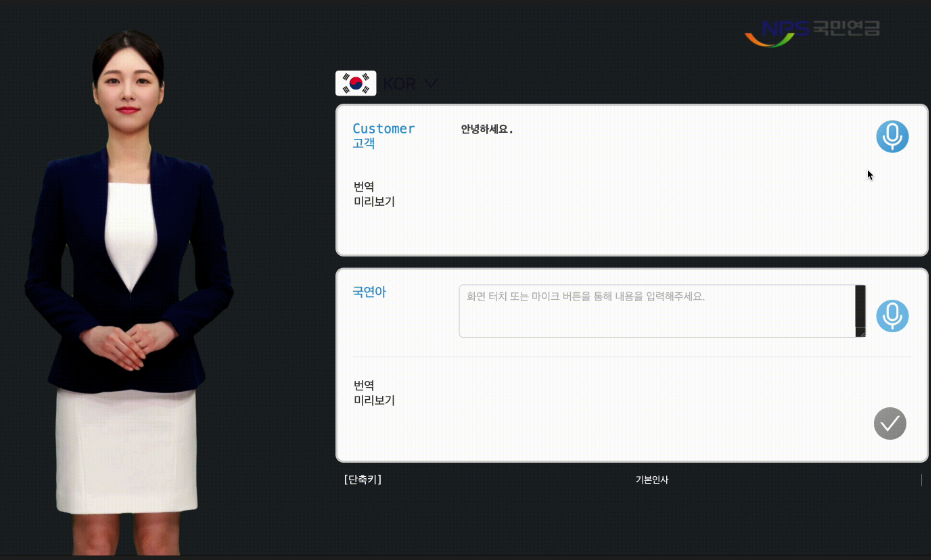
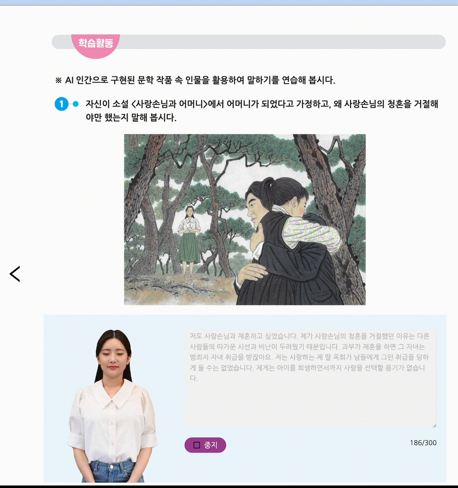
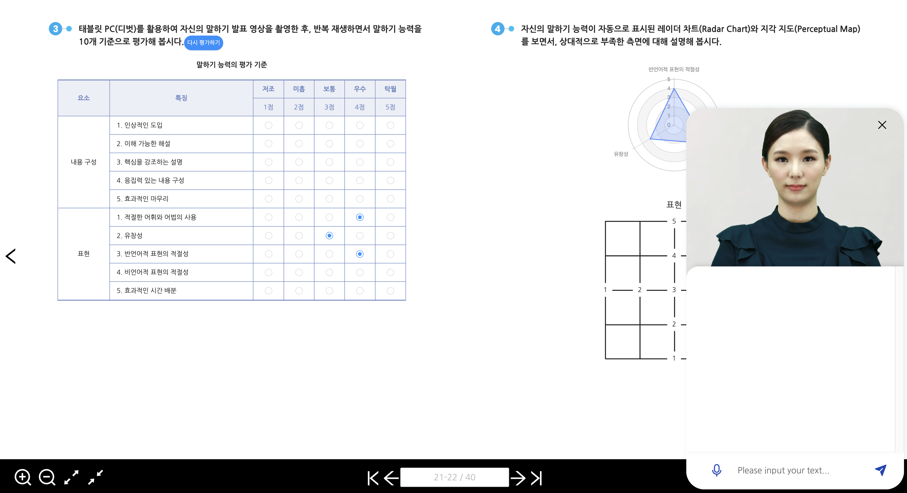
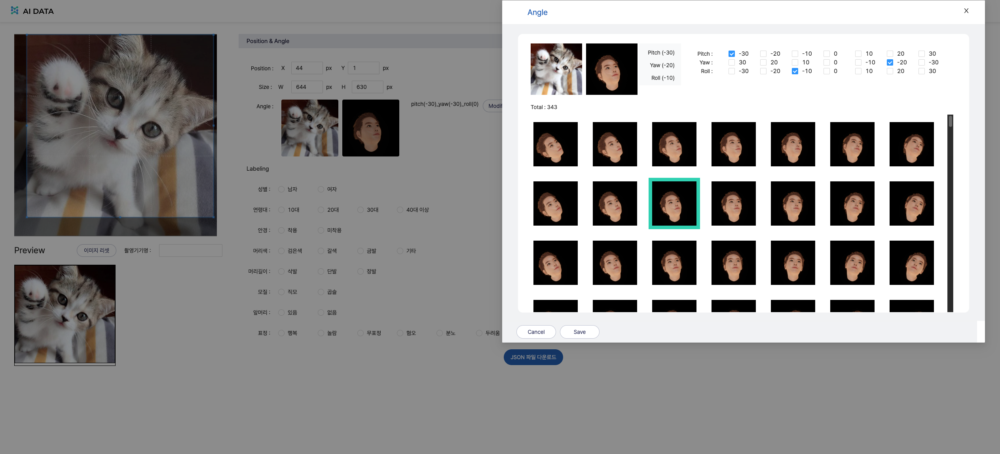

## 1. Outline

### 1.1. Profile

**안동주 (An Dongju)** | Frontend Engineer

+82 10-6303-2184 | andongjoo1@naver.com | [GitHub](https://github.com/dev-frankie) | [LinkedIn](https://www.linkedin.com/in/adj0715/)

제품 개발과 함께 프론트엔드 아키텍처, 개발 생산성, 품질과 배포 체계를 설계하고 운영해 온 5년차 프론트엔드 엔지니어입니다.

셀렉트스타에서 LLM 평가 플랫폼 DATUMO의 프론트엔드 파트를 리드하고 있습니다. 인증과 권한을 서버에서 처리하는 BFF 구조를 세우고, 온프레미스 고객사 4곳과 글로벌 SaaS를 한 코드베이스로 납품하는 배포 구조를 만들었습니다.

lint, 타입, 테스트, e2e 등 자동 검사 19개를 merge 조건으로 운영하고, AI 리뷰 하네스로 결함을 개발 단계에서 잡습니다. 순환 의존처럼 한 번 정리한 문제는 lint 규칙으로 다시 생기지 않게 막습니다.

이전에는 딥브레인AI에서 AI 영상 SaaS와 금융/공공기관 대상 온프레미스 프로젝트를 개발했습니다.

개발 환경이 편해야 팀이 제품을 빠르게 만든다고 생각해 개발자 경험(DX)을 꾸준히 개선해 왔습니다. 또한, 프론트엔드 성능 최적화에 강점이 있으며 개선 효과는 수치로 증명해 왔습니다.

이력서의 항목을 문제, 과정, 성과 순서로 풀어 썼습니다. 결과와 함께 처음 판단이 틀렸던 지점, 고르지 않은 대안과 그 이유, 고친 것이 실제로 고쳐졌는지 확인한 방법도 적었습니다.

### 1.2. SKILLS

| 구분           | 상세                                                                                                           |
| -------------- | -------------------------------------------------------------------------------------------------------------- |
| Language       | TypeScript, JavaScript                                                                                         |
| Frontend       | React 19, Next.js 16(App Router, Route Handler, Proxy), TanStack Query/Table, Zustand, Redux Toolkit/RTK Query |
| API / Auth     | OpenAPI(openapi-typescript, openapi-fetch, orval), Zod, BFF, JWE 세션, OAuth 2.0 + PKCE, SSO, SSE              |
| Test / Quality | Vitest, Playwright, type-aware ESLint, eslint-plugin-boundaries, Lighthouse CI, Sentry                         |
| Infra / CI     | GitHub Actions, Docker(standalone), Kubernetes, AWS, gitleaks, Dependabot                                      |
| AI Engineering | Claude Code, Codex, 작성자와 검증자를 분리한 리뷰 하네스(`@datumo/agent-harness`), MCP(codegraph, Lighthouse), ADR 기반 에이전트 컨텍스트 |

### 1.3. EXPERIENCE SUMMARY

**셀렉트스타** (Seoul, Korea) | 프론트엔드 파트 리더 _(2025.07 ~ 현재)_

> **DATUMO Platform** (LLM 평가, 레드티밍, Observability B2B 플랫폼)
>
> - 리뷰부터 배포까지 파트의 개발 체계 수립. 19개 자동 검사를 merge 조건으로 운영, 테스트 약 4,100 케이스 확보
> - 작성 모델과 검토 모델을 분리한 AI 리뷰 하네스 설계와 사내 패키지 배포
> - BFF 요청 경로, 3계층 권한 구조와 Rule Based 권한 키 설계
> - next-auth 제거와 자체 세션 계층, 구글과 Microsoft 로그인
> - 온프레미스 고객사 4곳과 글로벌 SaaS를 단일 코드베이스로 운영하는 배포 구조
> - OpenAPI 계약 자동화와 계약 검사 도구
> - 성능 진단 흐름과 개선. 랜딩 LCP 3.2초에서 2.0초, 44개 라우트 First Load JS 111KB 감소
> - Criteria AI 도구, 평가 대시보드, Observability, 다국어 파이프라인

**딥브레인 AI** (Seoul, Korea) | 프론트엔드 개발 _(2022.03 ~ 2025.03)_

> **AI Studios v3 서비스 개발**
>
> - 대규모 데이터 통계 대시보드, 요금제 확장/구독 해지 방어, 캔버스 에디터, 다국어/중국 리전
>
> **Account 서버 설계 및 백오피스 개발**
>
> - 자사 서비스 통합 로그인 npm 패키지, 인증, 통합 어드민, 백오피스
>
> **금융/공공 B2B 프로젝트**
>
> - 농협은행 AI 허브/키오스크, 국민은행 금융비서, 태블릿 AI 실시간 통역, AI 학습 데이터 플랫폼(정부과제), KB증권 PoC, 서울시교육청 AI 디지털 교과서, 월드비전 AI 시상영상

## 2. WORK EXPERIENCE

### 2.1. 셀렉트스타 (DATUMO Platform)

AI 학습 데이터 구축 기업 셀렉트스타의 LLM 평가 플랫폼. 기업이 자사 LLM 애플리케이션을 평가하고 레드티밍하며 운영 중 실패 사례를 추적하는 B2B 제품으로, 글로벌 SaaS와 금융/공공 등 고객사 온프레미스를 함께 운영

- 역할: 프론트엔드 파트 리더. 제품 레포, 어드민 레포, 공용 AI 리뷰 패키지 담당
- 규모: TS/TSX 약 4,000파일, API 라우트 364개
- Skills: TypeScript, Next.js(14에서 16으로 업그레이드), TanStack Query, Zustand, openapi-fetch, orval(zod), Vitest, Playwright, eslint-plugin-boundaries, GitHub Actions

---

#### 2.1.1 **파트 리딩과 품질 게이트**

**문제**

- PR에서 자동으로 도는 테스트와 검사가 없어, 결함은 수동 QA나 배포 후에야 발견되는 구조
- 글로벌 SaaS와 온프레미스 고객사 4곳을 한 코드베이스로 운영해, 회귀 하나가 모든 고객사로 번질 수 있는 환경

**과정**

- 업무 배분, 착수 전 설계 리뷰, 격주 기술 세미나, 신규 입사자 온보딩 담당. 큰 작업은 설계와 구현 가이드를 직접 맡고 구현은 파트원에게 넘겨 리뷰하는 방식으로 운영(권한 체계 개편 등). 일정과 요구사항은 PO/백엔드와 직접 조율
- 기술 부채를 테스트, 성능, CI/CD, 관측, 아키텍처, 유지보수, 보안 7개 축으로 진단하고, 진단 결과와 진행 상황을 팀 공유 문서로 계속 갱신. 해결 항목에는 실제 머지된 것만 기록
- PR마다 자동 검사 19개를 병렬 Job으로 나눠 돌리고, 하나라도 실패하면 merge 차단
  - 코드 규칙 4개(lint, 포맷, 안 쓰는 코드, Next 파일 위치 규칙)
  - 타입 3개(타입 검사, 타입이 의도대로 정의됐는지 확인하는 테스트, 아직 켜지 못한 엄격한 타입 규칙의 위반 개수 상한)
  - 테스트 2개(단위 테스트와 커버리지 최저선, 실제 빌드로 돌리는 e2e)
  - 빌드 1개
  - 다국어 3개(영어 원문과 코드 일치, 번역 키, 번역 설정 키)
  - 보안 4개(배포될 코드와 PR 커밋의 시크릿 유출, 추적 env 파일, 프로덕션 의존성 취약점)
  - 그 밖의 안전장치 2개(리다이렉트 주소, 스토어 쓰기 effect 수 상한)
- 타입 정보를 쓰는 lint는 캐시를 쓰면 다른 파일의 변경 영향을 놓칠 수 있어 캐시 없이 실행하고, 늘어난 시간은 병렬화로 회수
- 바로 켤 수 없는 규칙은 지금의 위반 개수를 상한으로 기록하고, 그보다 늘어나는 PR만 막아 위반이 줄어들기만 하도록 도입. 테스트 커버리지도 도입 당시 수치를 최저선으로 정해 내려가지 않게 하고, 테스트가 없는 파일도 계산에 넣어 수치가 부풀지 않게 측정
- 새로 만든 테스트와 검사가 실제로 문제를 잡는지 확인하는 절차를 정함. 버그를 고치며 추가한 테스트는 고치기 전 코드에서 실패해야 하고, 새 검사는 잘못된 코드를 넣었을 때 실패해야 제대로 된 테스트로 인정. 항상 통과만 하는 테스트를 걸러내기 위해서
- e2e 테스트를 merge 조건에 넣자마자, 로그아웃해도 곧 다시 로그인 상태가 되는 실제 버그 발견
- 설계 결정을 ADR로 기록. ADR마다 영향받는 파일 경로를 적어, AI 리뷰어가 변경과 맞는 결정을 먼저 읽고 리뷰하도록 연결

**성과**

- 테스트 약 4,100 케이스(524파일), 배포 전 자동 검사 19개
- ADR 13건 기록
- 파트 공동 과제로 클라이언트 번들 14.4% 감소, 수천 줄짜리 대형 컴포넌트 5개를 6,509줄에서 1,745줄로 분리, QA 시나리오 문서 321개 정비

---

#### 2.1.2 **AI 개발 방법론 (`@datumo/agent-harness`)**

**문제**

- AI 에이전트가 "테스트 통과, 문제없음"이라고 보고해도 그 보고를 검증하는 주체가 없었음. 같은 모델이 같은 맥락으로 자기 코드를 검토하면 같은 맹점을 두 번 통과시킴

**과정**

- 코드 리뷰에서 작성자와 리뷰어를 나누는 원칙을 그대로 적용해, 코드를 쓰는 모델(Claude)과 검토하는 모델(Codex)을 분리. 검토자에게는 대화 기록 없이 작업 요약 문서(handoff)와 변경 내용(diff), 검사 결과만 넘기고, 검토 지시문은 git으로 관리해 작성자가 바꿀 수 없게 고정
- 검토 모델은 지적 사항을 심각도 3단계로 나눠 정해진 형식으로 제출하고, 심각한 두 단계 중 하나라도 있으면 하네스가 실패로 처리
- 작성 모델과 검토 모델이 수정과 재검토를 최대 2라운드 주고받은 뒤, 남은 사항은 사람이 판단
- 검토 모델이 코드 그래프 MCP(codegraph)로 변경의 영향 범위를 분석하고, diff를 보기 전에 변경과 맞는 ADR과 도메인 문서를 먼저 읽도록 연결
- merge 차단은 타입 검사, lint, 테스트가 담당. AI 리뷰는 오탐이 얼마나 나오는지 충분히 지켜본 뒤 merge 조건에 넣기로 하고, 그 전까지는 결과만 PR에 남김
- 공유 npm 패키지로 추출해 규칙, 지시문, 게이트를 한 곳에서 관리하고 `sync`로 여러 레포에 전파. 각 레포의 로컬 수정은 덮어쓰지 않고 차이를 먼저 표시. 레포 접근 권한은 개인 토큰에서 조직 GitHub App으로 이전

**성과**

- 도입 첫날 하네스가 자기 자신의 결함 12건 발견(타입 검사가 크래시했는데 오류 0줄이라 통과로 처리하던 것 포함)
- 제품, 어드민, 문서 사이트 3개 레포 적용. 레포마다 복사해 쓰던 규칙의 차이 제거

---

#### 2.1.3 **BFF 요청 경로와 라우트 팩토리**

**문제**

- 정적 생성(SSG) 기반이라 서버에서 요청을 가로챌 수 없어, 인증 검증과 권한 기반 라우팅을 서버에서 할 수 없는 구조. 브라우저가 토큰을 들고 백엔드를 직접 호출

**과정**

- 정적 export(SSG) 방식으로 배포하던 앱을, API Route Handler를 BFF로 두는 서버 실행 구조(standalone)로 전환. Next.js는 14에서 16으로 업그레이드
- 모든 데이터 요청이 같은 경로(TanStack Query 훅, 공용 API 함수, same-origin BFF)를 거치도록 제한하고, BFF가 암호화 쿠키에서 꺼낸 토큰을 붙여 백엔드를 호출. 다른 경로는 lint로 차단
- 라우트마다 반복되던 파라미터 파싱, 인증 헤더, 프록시 호출, 응답 검증 코드를 선언형 라우트 팩토리로 통합. 다만 팩토리가 바디 스키마를 필수로 요구해 바디가 없는 POST(clone, retry, stop 등) 97개 중 68개는 팩토리를 쓸 수 없었음. 빈 스키마를 억지로 넣는 대신 팩토리의 타입을 고쳐 바디 스키마를 선택 사항으로 변경
- 스트리밍, 바이너리, 파일 업로드 라우트는 팩토리로 옮기지 않음. 팩토리는 사용자가 요청을 취소해도 백엔드에 알리지 못해서
- BFF의 에러 응답 형식을 `{ error: { code, message } }` 하나로 통일. 브라우저는 이 code를 보고 세션 만료 같은 처리를 결정
- 세션이 만료된 사용자가 빈 화면에 남는 결함을 추적한 결과, 일부 라우트가 401에 에러 코드를 싣지 않아 브라우저가 그 응답을 무시하던 것이 원인. 401을 만드는 지점 19곳을 공용 함수 하나로 통일해, 새 라우트도 같은 응답을 쓰도록 고정

**성과**

- 토큰과 백엔드 주소를 브라우저에서 제거
- 팩토리를 쓸 수 없던 라우트 68개를 0개로 줄이고, 이후 파트원과 함께 이관을 이어가 현재 API 라우트 364개 중 316개가 팩토리 사용
- 세션 만료 시 빈 화면에 남던 라우트 55개 복구

---

#### 2.1.4 **3계층 권한 구조와 Rule Based 권한 키**

**문제**

- 화면마다 역할(owner, admin 등)을 직접 비교해 권한을 판단하는 구조라, 역할 구성이 바뀌면 프론트 곳곳의 비교 코드를 찾아 고쳐야 했음
- 조직(Organization)과 워크스페이스 역할을 함께 다루는 권한 모델이 필요해진 상황

**과정**

- Organization과 Workspace 역할이 하위 Application 권한까지 이어지는 3계층 구조 설계. Organization의 Owner와 Admin은 Workspace 권한을 물려받고, Application 권한은 Workspace 역할에서 나오도록 정리
- 어떤 역할이 어떤 권한을 갖는지는 백엔드 규칙(Rule Based)이 정하고, 프론트는 `/api/member/me`가 내려주는 플랫폼, 조직, 워크스페이스 범위의 권한 키(`resource.action`)만 확인하도록 계약 정리
- 화면 노출 판단은 `usePermissions` 훅 하나로 통일. 화면의 판단은 UI 노출에만 쓰고 실제 권한 검사는 서버가 매 요청마다 수행
- 설계와 구현 가이드를 맡고, 파트원의 구현 PR을 리뷰

**성과**

- 역할 구성이 바뀌어도 프론트 수정 없이 반영되는 구조
- 120여 개 파일, 150여 곳의 권한 판단을 함수 하나로 통일

---

#### 2.1.5 **next-auth 제거와 자체 세션 계층**

**문제**

- 세션은 `next-auth@5 beta` 위에서 동작했지만 실제로 쓰는 기능은 Credentials 로그인과 암호화 쿠키뿐. ID 연동은 백엔드가 이미 담당했고, 인증 코드 대부분이 라이브러리를 우회하는 코드
- Auth.js는 세션을 읽을 때마다 쿠키를 새로 씀. 로그아웃 직전에 출발한 요청이 뒤늦게 도착해 지운 쿠키를 되살렸고, 로그아웃해도 곧 다시 로그인 상태가 되는 버그를 e2e 테스트가 발견
- Session 객체가 브라우저로 전달되는 구조라 그 위에 실린 백엔드 토큰도 함께 노출. 보안 감사에서 최상위 등급으로 지적된 항목
- 소셜 로그인은 기존 회원의 로그인인지 신규 가입인지에 따라 다음 화면이 달라지는데, 라이브러리의 `signIn()`은 성공 여부만 반환

**과정**

- 먼저 라이브러리를 유지한 채 토큰을 Session에서 빼는 우회 방식을 적용(ADR-0004). 동작은 했지만 우회 코드가 한 겹 늘어남
- 라이브러리가 제공하는 ID 연동은 쓰지 않으면서, 필요한 쿠키 쓰기 시점 제어와 소셜 로그인 결과 전달은 라이브러리에 막혀 있다고 판단해 자체 세션 계층으로 교체(ADR-0005)
- 쿠키는 내용이 바뀔 때만 쓴다는 원칙으로 설계. 로그인, 토큰 회전, 만료, 로그아웃에서만 쿠키를 써서 쿠키가 되살아나는 경로를 제거. 세션은 JWE로 암호화한 쿠키에 저장하고, HTTPS에서는 다른 서브도메인이 쿠키를 심을 수 없도록 설정
- 쿠키를 쓸 수 있는 곳(Route Handler, Proxy)과 읽기만 하는 곳(Server Component)을 나눠 토큰 갱신은 쓸 수 있는 곳에서만 일어나게 함. 401이 동시에 몰려도 토큰 갱신은 한 번만 일어나도록 중복 제거
- 구글 로그인은 BFF가 authorization code 플로우(PKCE)를 수행해 브라우저가 구글 토큰을 갖지 않는 구조(ADR-0006). 로드밸런서 뒤 어느 인스턴스로 콜백이 와도 처리되도록 진행 중 상태를 10분 동안만 유효한 암호화 쿠키에 보관
- Microsoft 로그인을 같은 BFF 플로우에 추가하고, 이메일이 없는 Microsoft 계정은 실패 사유를 알려주는 화면으로 안내(ADR-0011~0013)

**성과**

- next-auth 의존성 완전 제거(127개 파일 변경). Auth.js를 쓰려고 덧대던 회전 추적, 토큰 보관소 등 우회 코드 제거
- 백엔드 토큰이 브라우저에 노출되는 경로와 로그아웃 후 세션이 되살아나는 버그를 원인 단위에서 제거
- 같은 계층 위에 구글, Microsoft 로그인과 가입, 온보딩 추가

---

#### 2.1.6 **온프레미스/멀티 테넌트 배포 구조**

**문제**

- 금융/공공 고객사마다 요구가 다름. 포털 SSO로만 로그인하고 계정 기능을 꺼야 하는 곳, HTTPS 없이 사내망 HTTP로 서비스하는 곳, 비밀번호 로그인만 쓰는 곳이 공존
- 기존 고객사별 기능 표는 테넌트마다 boolean 표 하나라서, SaaS와 온프레미스의 기본값 차이나 로그인 방법 같은 목록형 설정을 표현할 수 없었음. 고객사가 늘 때마다 코드 분기도 늘어나는 구조

**과정**

- 기능 값을 배포 환경변수, 테넌트 설정(에디션 기본값과 다른 값만), 에디션 기본값(SaaS, 온프레미스) 순서로 찾고, 먼저 값을 정한 층을 따르도록 변경
- 로그인 방법을 목록형 설정(`signInMethods`)으로 분리. 알 수 없는 값이 들어와도 로그인 수단이 하나도 없는 상태가 되지 않도록 기본값으로 복귀
- HTTP로만 서비스하는 고객사는 `Secure` 쿠키와 `__Host-` 접두사를 쓸 수 없어, 세션 쿠키 이름과 속성을 origin에 따라 선택. 금융권 포털 SSO는 일회성 토큰을 검증한 뒤 해당 그룹의 워크스페이스로 바로 이동
- 고객사별 환경 파일과 실행 스크립트를 `.env.onprem.<tenant>`, `<cmd>:onprem:<tenant>` 규칙으로 정리하고 standalone Docker 이미지로 납품
- 기존 테스트를 고치지 않은 채 통과시켜 기존 동작이 바뀌지 않았음을 확인

**성과**

- 온프레미스 고객사 4곳과 글로벌 SaaS를 한 브랜치, 한 코드베이스로 운영
- 기능 코드에는 고객사별 분기를 두지 않고, 고객사의 새 요구는 설정 항목으로 추가(유휴 로그아웃 시간, 레드티밍 전용 메뉴 등). 가장 최근 고객사는 파트원이 고객사 등록과 설정 추가로 연결

---

#### 2.1.7 **API 계약 자동화와 타입 안전성**

**문제**

- 백엔드 API 타입을 수기 파일로 관리해, 백엔드가 경로나 필드를 바꾸면 런타임에야 드러남
- `strict: true`였지만 타입 정보를 쓰는 ESLint 규칙은 꺼져 있었고, 프로덕션 코드에 `as unknown as` 이중 단언 40곳, 배열 인덱스 접근은 `undefined`를 반영하지 않는 상태

**과정**

- 백엔드에 OpenAPI 스펙 기반 타입 생성을 제안해 도입(엔드포인트 300개 이상, 스키마 800개 이상). 코드에 적은 경로가 스펙에 없으면 빌드 실패
- 타입과 테스트로는 잡히지 않는 결함을 찾으려고 계약 검사 도구(`audit:paths`) 제작. 브라우저 호출부, BFF 라우트, 스펙 경로를 대조해 라우트 없는 호출, deprecated 경로 사용, 스펙에 없는 프록시를 검출. 경로가 상수가 아닌 문자열로 적혀 있어 모든 게이트를 통과하던 애플리케이션 생성 404가 대표 사례
- 세 검사마다 실제 결함을 다시 넣어 도구가 잡는지 확인. 마지막 오탐은 예외 목록에 넣는 대신 파싱을 고쳐 해결했고, 소스 텍스트에서 의도를 추정하는 도구라 결과는 단서로만 쓰고 빌드를 막는 게이트로는 쓰지 않음
- `as unknown as` 중 30건은 생성 타입으로 바꾼 뒤에야 지울 수 있다고 보고 보류해 둔 상태. 실제로 지워 보니 28건은 타입 오류가 0건이었고, 옆 줄에서 복사된 단언이었음. 이후 계획의 다른 단계도 전제부터 다시 측정하는 것을 원칙으로 삼음. 남은 11건에는 근거 주석을 달고 신규 유입은 lint로 차단
- 감사 중 직접 낸 실수도 있었음. 어느 호출부도 넘기지 않는 prop이라 판단해 지웠는데, 근거로 본 검색 결과가 잘려 5곳 중 2곳만 확인한 상태였음. 게이트는 모두 통과했고 PR 리뷰에서 발견. 이후 삭제 근거는 전수 조사로만 판단
- 타입 정보를 쓰는 ESLint 규칙과 `noUncheckedIndexedAccess`를 켜서 드러난 221건을 전수 수정. 사용처마다 고치는 대신 변수 정의 지점에서 한 번 좁혀, 가드 하나로 수십 건이 함께 풀린 경우도 있었음. 바로 켤 수 없는 `exactOptionalPropertyTypes`는 위반 수를 CI에 고정하고 감소만 허용

**성과**

- 수기 경로 타입 3,984줄에서 591줄로 축소, API 계약 불일치를 빌드 단계에서 검출
- 테스트로는 드러나지 않던 레거시 API 호출 등 결함 4건 발견 및 제거
- 프로덕션 코드의 `as unknown as` 40건에서 11건으로 축소(남은 건은 모두 근거 주석), 잠재 타입 오류 221건 해소

---

#### 2.1.8 **모듈 경계와 상태 관리**

**문제**

- FSD(Feature-Sliced Design) 규칙이 문서로만 있어 feature 간 직접 import 39건, 순환 의존 33건이 누적
- 전역 상태가 Recoil atom 429개로 흩어져 흐름을 따라가기 어려움
- 수백 줄짜리 컴포넌트가 로컬 상태를 effect로 전역 스토어에 복사하는 패턴이 반복돼, 값의 출처가 두 곳으로 갈리는 버그 발생

**과정**

- `eslint-plugin-boundaries`로 레이어 의존 방향과 슬라이스 공개 API를 강제하고 경계 검사 자체에도 테스트 추가. 순환 의존 33건을 없앤 뒤 `import/no-cycle` 활성화
- Recoil에서 Zustand로 옮길 때 기존 atom 이름을 selector로 감싸, 화면 코드를 고치지 않고 도메인별로 점진 이관. 이관 방식은 직접 설계하고 작업은 파트원과 나눠 진행
- 큰 컴포넌트는 나누기 전에 특성화 테스트로 현재 동작부터 고정. 스토어에 쓰는 effect의 수를 세는 검사를 CI에 래칫으로 걸어 같은 패턴의 재발 차단

**성과**

- feature 간 직접 import와 순환 의존 0건, 위반 시 PR 차단
- Recoil atom 429개를 도메인별 Zustand 스토어 20여 개로 정리

---

#### 2.1.9 **성능 진단 체계와 개선**

**문제**

- 평가 상세 진입이 느렸지만, 실사용자 지표와 랩 측정을 연결해 원인을 찾는 체계가 없던 상태
- Sentry 기준 랜딩 페이지의 LCP p75가 5.3초로 앱에서 가장 느렸음. 화면을 그리지 않고 리다이렉트만 하는 페이지

**과정**

- 랜딩 페이지는 서버 컴포넌트에서 `redirect()`를 호출하는데도 307이 아니라 200으로 응답하고 있었음. App Router는 응답 셸을 먼저 보내기 때문에 page의 리다이렉트는 RSC 페이로드에 담기고, 브라우저가 JS를 받아 하이드레이션을 마친 뒤에야 이동. 리다이렉트를 Proxy로 옮겨 307로 바로 응답하도록 변경. CPU를 3배 느리게 해도 개선폭이 같아, 병목이 연산보다 하이드레이션을 기다리는 왕복에 있음을 확인
- 수정 후에는 `/`가 307로 바로 넘어가 페이지 로드 기록 자체가 사라지므로, 필드 지표로는 전후 비교가 불가능. 수정 전후 커밋을 각각 빌드해 같은 조건(Lighthouse 데스크톱, 콜드 캐시, 5회 median)으로 측정. 이후 상대 URL 리다이렉트가 스테이징에서 500을 일으켜 절대 URL로 되돌리고, 같은 실수를 막는 검사를 CI에 추가
- 평가 상세의 Task 결과 테이블은 Server Component에서 쿼리 캐시를 미리 채우고 목록에서는 호버 시점에 프리페치. Playwright와 User Timing으로 4개 케이스를 케이스당 5회씩 측정해 효과를 검증
- 번들 분석기가 청크 이름만 보여줘 다음 행동이 나오지 않아, 청크 안의 패키지와 줄이는 방법을 함께 보여주는 랭킹 도구 제작. 이 도구로 차트 라이브러리 두 개(echarts, recharts)가 공유 청크에 함께 실리던 문제 발견
- recharts를 쓰는 대시보드는 `dynamic()`으로 지연 로딩해도 초기 번들에서 빠지지 않았음. 추적해 보니 모든 라우트에 실리는 모달 등록 모듈이 같은 barrel에서 import하고 있어 recharts가 함께 딸려 들어가던 것이 원인. barrel 재수출을 끊어 분리
- 가상화는 도입 후 46행부터 5만 행까지 합성 데이터로 다시 측정. 초기 렌더는 1,000행부터(677ms에서 90ms), 스크롤은 5,000행부터(15.6fps에서 63.4fps) 이득이었고, 현재 페이지 크기(최대 100행)에서는 스크롤이 오히려 나빠짐. 처음 성과로 적었던 DOM 46행에서 18행 감소는 동작 확인용 지표였다고 보고 철회
- 상호작용 지연을 입력 지연, 처리, 페인트로 나눠 재는 INP 랩 측정 하네스 구축. 프로덕션 빌드를 CPU 3배 감속 조건에서 띄워 Run 목록 행 펼침 같은 주요 상호작용을 측정
- Lighthouse CI(라우트별 3회 median, 인증 라우트는 쿠키 주입) 결과와 main 대비 번들 증감, Top 15 패키지를 PR 코멘트로 자동 게시. 라우트별 예산은 기준을 실측으로 확정할 때까지 경고 단계로 운영

**성과**

- 랜딩 LCP 3.2초에서 2.0초로 38% 단축(랩 측정, 5회 median), 성능 점수 81점에서 90점
- 평가 상세 진입 시간 평균 422ms에서 323ms로 23% 단축(가상화를 켠 상태 기준, 가장 크게 줄어든 케이스 497ms에서 148ms). 네 케이스 중 하나는 224ms에서 353ms로 오히려 느려져 케이스별 편차가 큼
- 44개 라우트의 First Load JS 111KB(gzip) 감소. Red Teaming 태스크 화면 기준 947KB에서 836KB로 11.7% 감소
- 가상화 적용 기준(초기 렌더 1,000행, 스크롤 5,000행) 수립, Run 목록 행 펼침 INP 32ms 확인(33행, CPU 3배 감속, 6회 median)

---

#### 2.1.10 **운영과 보안**

**문제**

- task, run, version, judge model 같은 이름이 여러 도메인의 API 응답에 중복으로 실려, 이름을 바꿔도 다른 화면의 목록에는 이전 이름이 남는 버그가 반복. 약 150개 mutation이 약 135개 query 중 무엇을 갱신해야 하는지 각자 기억해야 하는 구조
- 외부 진단에서 보안과 거버넌스가 최하위 영역으로 평가됨. git이 추적하는 환경 변수 파일에 인증 비밀값과 테스트 계정 정보가 있었고, CODEOWNERS, 시크릿 스캔, 의존성 보안 자동화가 없던 상태

**과정**

- 쿼리 캐시와 mutation 캐시의 공통 onError에서 API 오류를 Sentry로 보고하고, 세션을 끝내는 401에서만 한 번 로그아웃하도록 일원화
- 성공한 mutation은 전체 캐시를 무효화하되, 즉시 다시 요청하지 않고 표시만 하도록(`refetchType: "none"`) 표준화. 추가 요청 없이 다음에 화면이 열릴 때 최신 값을 가져오고, 캐시에 영향이 없는 mutation(미리보기, 연결 테스트 등)은 meta 플래그로 제외
- 프로필 쿼리가 한 번 실패하면 복구되지 않는다는 티켓을 받고 query-core 소스를 읽어 전제가 틀렸음을 확인. 실제 결함은 반대로, 한 번 성공하면 세션 내내 갱신되지 않는 것이었음. 정책을 고친 뒤 테스트 4건을 추가하고, 옛 정책으로 되돌리면 2건이 실패하는 것까지 확인
- 인증, BFF, 배포 설정에 CODEOWNERS를 지정하고 gitleaks를 현재 코드와 PR 커밋 범위에 이중 적용. 현재 코드만 검사하면 커밋 이력에 남은 유출을 놓치기 때문
- 추적 중인 env 파일에서 인증 비밀값과 테스트 계정 정보를 제거하고, 추적 가능한 env 파일을 허용 목록으로 CI에서 검사
- 사용자에게 배포되는 프로덕션 의존성 취약점만 merge를 막고 개발 의존성은 주간 리포트로 분리. 둘 다 막으면 merge가 너무 자주 막혀 팀이 경고를 무시하는 습관이 생긴다고 판단

**성과**

- 이름을 바꾼 뒤 다른 화면에 이전 이름이 남던 문제를 추가 요청 없이 해결
- 보안 기준선 수립(CODEOWNERS, 시크릿 이중 스캔, 의존성 게이트), 추적 저장소의 비밀값 노출 제거
- Dependabot 경고 누적 139건 해소(파트 리드로서 승인하는 레포 전체 기준)

---

#### 2.1.11 **주요 기능 개발**

**Criteria AI 도구와 실시간 협업 페이지**

- 평가 기준을 AI로 생성, 수정, 검증, 증강하는 Generator, Modifier, Validator, Augmenter 설계와 개발. 컬럼 단위 생성과 전체 생성, 템플릿 기반 Setup, 버전 히스토리 포함. 레포에서 가장 큰 기능 영역(약 420개 파일 중 189개 작성)
- SSE 기반 실시간 협업 페이지 개발. 스냅샷, 작업 진행, 프레즌스, 버전 4개 이벤트로 지금 보고 있는 사람을 표시하고, 세션 ID로 내가 보낸 변경이 되돌아와 화면이 두 번 바뀌는 것을 방지. 다른 사람이 먼저 저장했으면 충돌을 알리고 최신 내용을 반영. 탭을 닫을 때도 퇴장 신호가 가도록 `sendBeacon` 사용

**워크스페이스 전환 충돌**

- 서버가 회원마다 현재 워크스페이스 값을 하나만 가지고 있어, 탭 두 개를 열면 서로 그 값을 덮어써 전환이 되돌아가고 404 뒤 다른 화면으로 튕기는 문제. 모든 워크스페이스를 읽을 수 있는 슈퍼 어드민 계정에서는 드러나지 않았음
- 두 탭 시나리오를 Playwright로 재현한 뒤, URL을 애플리케이션의 단일 기준으로 삼고 워크스페이스는 애플리케이션별로 한 번 알아낸 값을 기억하도록 재설계(ADR-0003). 값을 모를 때는 요청을 만들지 않고 기다리도록 변경

**그 밖의 기능**

- 평가 대시보드, Eval Runs, Observability 실패 사례 목록/상세/커스텀 메트릭, LLM 애플리케이션 API 연동(멀티턴 포함) 개발
- Stripe와 토스 결제 개발 중
- 사내 운영용 어드민 콘솔 레포 단독 구축(인증, 배포 CI, AI 리뷰 하네스 연동). 대화 로그가 CloudWatch를 거쳐 Observability QA로 이어지는 챗봇 테스트 화면 포함

**다국어 파이프라인**

- 개발자가 `en/ko/ja.json`을 직접 고치다 보니 머지 때 영어가 한국어, 일본어 파일로 역류. 키 값마다 주인을 하나로 정해 흐름을 한 방향으로 정리. 영어 원문은 코드가, 한국어와 일본어는 스프레드시트에서 번역가가 소유하고 동기화는 CI가 자동 PR로 처리(지금까지 23회 반영)
- 안 쓰는 키를 지울 때는 동적으로 조합되는 키가 지워지지 않도록 네 가지 조건을 모두 만족할 때만 지우고, `--dry-run`으로 먼저 확인하는 절차 추가
- 번역 키 약 4,200개를 머지 충돌 없이 운영, 영어 역류를 복구하던 응급 스크립트 제거

---

### 2.2. 딥브레인 AI (AI Studios v3)

AI 가상인간으로 개인화된 영상 콘텐츠를 만드는 SaaS 플랫폼. v2에서 v3로 넘어가는 전면 리팩토링에서 설계 리뷰에 참여하고 어드민, 아바타와 템플릿 카탈로그 페이지 담당. Redux Toolkit/RTK Query 전환과 SSR, 디바운싱, 코드 스플리팅으로 FCP/LCP/TTI 평균 30% 이상 단축

#### 2.2.1 **대규모 데이터 통계 대시보드**

1,000만 건 이상의 프로젝트 데이터를 조회하는 통계 대시보드와 데일리 리포트 자동화 시스템 구축

- 기여도: 100%
- Skills: Next.js, Kubernetes, Chart.js, MongoDB

**문제**

- 유저 유입, 프로젝트 사용 현황, 에러율 같은 통계를 한눈에 파악하기 어려움
- 기관별, 팀별, 개인별 분석 데이터가 없어 운영 판단의 근거 부족
- 1,000만 건 이상 데이터를 기간별로 조회할 때마다 집계에 3초 이상 소요

**과정**

- 조회할 때마다 원본 데이터를 집계하는 것이 병목이라고 보고, 미리 집계해 두고 조회는 읽기만 하도록 구조 변경
- 쿠버네티스 기반 Cron 배치로 매일 기관/팀/개인별 프로젝트, 유저 로그를 수집하고 로우 데이터를 정제해 운영진에게 메일 리포트 자동 발송
- MongoDB 사전 집계 API로 통계 대시보드를 개발해 조회와 분석 지원, Chart.js 코드 스플리팅으로 초기 번들 축소

**성과**

- FCP 1.2초에서 0.4초(약 67% 감소), LCP 4.5초에서 2.2초(약 51% 감소), 조회 응답 3초 이상에서 1초 미만으로 단축
- 운영팀이 기관, 팀, 개인 단위 사용 현황을 매일 메일로 받아보는 리포트 체계 마련

---

#### 2.2.2 **요금제 확장 및 구독 해지 방어 시스템**

- 기여도: 100%
- Skills: Next.js, Kubernetes, Stripe

**문제**

- 레거시 요금제와 신규 요금제를 병행하면서 요금제 간 기능, 권한 관리 로직이 섞여 코드 복잡도 증가
- 요금제별 권한과 접근 제어가 명확히 구분되지 않아 같은 기능이 중복 구현됨
- 구독 해지 과정에서 고객 피드백을 수집하고 분석할 체계 부재

**과정**

- 권한 분기가 코드에 흩어진 것이 원인이라고 보고 권한을 데이터로 모델링한 뒤 훅으로 추상화. 해지는 확인창 하나로 끝내지 않고 단계별 방어 퍼널로 설계
- 기능별 접근 권한 필드를 DB에 추가해 권한을 데이터로 관리하고, 요금제 권한을 가져오는 커스텀 훅으로 중복 코드 제거
- 구독, 업그레이드, 다운그레이드 기준을 동적으로 판단하는 매트릭스 설계
- 설문으로 해지 이유를 수집하고 크레딧, 할인 리워드를 제안해 유지를 유도하는 해지 방어 퍼널과 해지 히스토리 관리 페이지 구축, Stripe 연동

**성과**

- 레거시 요금제를 유지한 채 신규 요금제 확장, 출시 후 약 2개월간 신규 구독 300건
- 요금제별 권한 분기를 데이터와 훅으로 옮겨 기능마다 반복되던 권한 코드 제거
- 해지 사유와 이력을 기록해 개선 방안을 찾을 데이터 확보

---

#### 2.2.3 **캔버스 기반 에디터 신규 개발 및 유지보수**

- 기여도: 100%
- Skills: Next.js, Fabric.js, Redux, Canvas, FFmpeg

> **기능 요구사항 1.** 텍스트 입력으로 생성형 AI 이미지와 비디오를 만들어 웹 에디터에 연동

**문제**

- 이미지와 비디오는 생성 시간이 일정하지 않아 즉시 응답을 받을 수 없고, 캔버스 안의 미디어 객체 관리도 복잡해짐

**과정**

- 생성 작업(Job) 목록을 주기적으로 조회해 결과를 비동기로 반영하면 편집 흐름을 막지 않는다고 보고, 사용자 텍스트로 이미지와 비디오를 생성하는 API 연동
- ChatGPT 연동으로 미디어 생성 힌트 제공, Fabric.js로 생성 미디어 속성을 분석해 캔버스에 추가하고 Redux 미들웨어로 DB 저장

**성과**

- 텍스트 입력만으로 이미지와 비디오를 생성해 캔버스에 바로 배치하는 흐름 제공

---

> **기능 요구사항 2.** 에셋 정렬 기준을 바로 확인할 수 있는 에디터 내 스냅 가이드

**문제**

- 에셋을 추가할 때 오브젝트 간 정렬과 간격 조절 로직이 복잡하고, 위치가 바뀔 때마다 좌표 계산과 렌더링이 필요

**과정**

- 병목이 매 프레임 재계산에 있다고 보고, 드래그 시작 시 한 번만 계산하고 축별로 후보를 줄이는 방향으로 설계
- 각 오브젝트의 시작, 중앙, 끝 좌표를 배열로 관리하고, 선택 오브젝트 좌표와 비교해 겹치는 기준선을 감지해 가상으로 렌더링. 임계값 이내로 접근하면 자동 정렬(스냅)
- 드래그 시작 시 좌표 1회 캐싱, 축별 사전 필터링, 가이드라인 DOM 렌더 분리로 좌표 비교 오버헤드를 줄여 드래그 중 실시간 피드백 유지

**성과**

- 에셋이 많은 대형 캔버스에서도 드래그 중 프레임 드랍 없이 정렬 가이드 표시

---

> **기능 요구사항 3.** 비디오 에셋 편집(트림) 기능

**문제**

- 비디오 썸네일 추출 시 서버 부하가 우려됐고, 비디오를 바꿀 때 캔버스와 DB를 동시에 갱신하는 과정과 이동, 크기 조절, 트림 상호작용에서 사이드이펙트 발생

**과정**

- FFmpeg으로 썸네일 추출 속도 저하 해결, 슬라이더 기반 구간 설정 제공, 트림 시 이전 상태를 Redux와 DB에 저장해 복구 지원
- 트림 모드에서 Video Element로 재생과 구간 미리보기를 제공하고, Canvas, Redux, Video Element의 편집 상태를 하나로 맞춘 뒤 트림 종료 시 썸네일 재생성

**성과**

- 에디터 안에서 비디오 트림, 썸네일 미리보기, 재생 지원

---

> **기능 요구사항 4.** 에셋 툴바 컴포넌트 설계 및 구현

**문제**

- 에셋마다 지원 기능이 달라 툴바를 동적으로 렌더링해야 하고, 좁은 화면에서는 일부 기능이 가려짐

**과정**

- 특정 크기 이하에서는 Floating 모드로 바꾸기로 하고, `useResizeObserver`로 툴바와 화면 크기를 감시해 임계값 이하가 되면 자동으로 Floating 모드 전환
- React Portal로 툴바를 최상위 DOM에 렌더링해 화면에서 사라지지 않도록 위치를 동적으로 조정

---

> **기능 요구사항 5.** 홈페이지에서 AI Studios 에디터와 기능 연동(Powerpoint to AI Video, AI Generator, URL to Video, Audio/Video Converter)

**문제**

- 웹플로우 기반 홈페이지와 Next.js 기반 AI Studios 기능을 통합하면서 쿼리 파라미터 전송 보안과 두 시스템 간 통신을 보장해야 하는 상황

**과정 (기여도: 스크립트 삽입 100%, 기능 연동 30%)**

- AI Studios 쪽에는 홈페이지 origin 허용 설정과 홈페이지용 API 정의, 연동
- 홈페이지 쪽에는 웹플로우 커스텀 코드(HTML, JavaScript) 삽입

**성과**

- 홈페이지에서 AI Studios 기능으로 바로 들어가는 진입 경로 마련, 이후 기능 추가에 쓸 베이스 코드 정리

---

#### 2.2.4 **마케팅 도구를 활용한 전략 지원 및 캠페인**

**문제**

- 사업 전략 분석 체계와 유저 행동 로그 같은 근거 데이터 부족. 비디오 합성 시간이 길어 결과를 보기 전에 이탈하는 사용자가 있었고, 유저별로 맞춘 이메일 캠페인도 부족

**과정**

- GA4, Amplitude, Baidu Analytics로 이벤트 태그 설정, 행동 세분화, 구매/전환 추적
- 커스터마이징 입력 폼으로 사용자 데이터를 수집해 HubSpot CRM에 연동, 리드 분석 지원
- 사용자별 G2 API 키를 발급하고 리뷰 데이터를 동적으로 임베딩하는 G2 인앱 리뷰 연동
- 합성이 끝나면 Service Worker 웹 푸시와 AWS SES 메일로 완료 알림 발송
- 신규/기존 유저 대상 A/B 테스트로 전환율이 높은 데모 페이지 도출
- 쿠버네티스 기반 메일 발송 자동화로 유저 그룹별 드립 이메일 캠페인 운영과 추적
- 회원가입 시 설문 결과로 대시보드 구성 최적화

**성과**

- 마케팅팀이 GA4와 Amplitude에서 사용자 행동과 전환을 직접 조회하는 이벤트 체계 마련
- 합성 완료 알림으로 결과 확인 전에 이탈하던 흐름을 보완하고, HubSpot과 G2 연동으로 리드와 리뷰 데이터를 수집하는 경로 확보

---

#### 2.2.5 **글로벌 다국어 지원 및 지역화 서비스**

**문제**

- 다국적 사용자를 위해 다국어와 지역화가 필요했고, 국가별 로그인과 결제 수단 같은 요구사항, 수기 번역 관리의 비효율도 있었음

**과정**

- next-i18next로 번역과 언어 전환 구현, 언어별 텍스트 길이를 고려한 반응형 UI로 주요 컴포넌트 레이아웃 유지
- 중국 시장용 위챗 로그인, 알리페이 결제 등 리전 전용 기능 개발과 리전별 기능 제한 적용
- 번역 키와 언어 매핑을 Google Sheet와 JSON 사이에서 동기화하고 Node.js 스크립트로 자동화

**성과**

- 10개 언어 지원과 중국 리전 대응(위챗 로그인, 알리페이 결제, Alibaba Cloud 배포), 번역 반영을 스크립트로 자동화

---

### 2.3. 딥브레인 AI (Account 서버, 백오피스)

#### 2.3.1 **자사 서비스 통합 로그인 모듈 패키지**

**문제**

- 자사 서비스마다 로그인 방식이 달라 사용자가 서비스를 옮길 때마다 다시 로그인해야 했고, 서비스마다 인증을 중복 구현

**과정**

- NextAuth 기반 OAuth 로그인 모듈을 npm 패키지 `@deepbrain/next-auth-account`로 개발, 배포(설치만으로 적용, Atomic Design)
- 6종 소셜 로그인(Google, MS, Apple, Facebook, WeChat `snsapi_login`, Alipay RSA-SHA256 커스텀 서명) 통합, Redis 싱글턴 세션으로 서비스 간 SSO 구현

**성과**

- 서비스마다 구현하던 로그인을 패키지 설치로 대체하고, SSO로 서비스 간 재로그인 제거

---

#### 2.3.2 **로그인 인증, 어드민 백오피스 서버**

**문제**

- 로그인 인증을 맡을 중앙 서버와, 기업, 부서, 사용자, AI 리소스를 관리할 어드민 시스템이 필요

**과정**

- 회원 비즈니스 로직(Facade 패턴), Redis 기반 중복 로그인 방지(유저 key 관리), 탈퇴 후 30일이 지난 계정을 자동 삭제하는 CRON 배치
- 기업/부서/멤버 통합 관리 어드민 페이지(관리자 권한별 기능), HOC 패턴으로 권한별 컴포넌트 계층화
- AI Voice 리소스 관리(샘플 보이스 API, 입력 폼), AI Avatar 리소스 관리(Fabric.js 시각 에디터로 좌표 편집), 사용자 정의 단어사전(치환 기능)

**성과**

- 기업, 부서, 멤버, AI 리소스 관리를 어드민 하나로 통합하고 SSO 통합 인증 서버 운영

---

### 2.4. 딥브레인 AI (B2B, 대형 SI 프로젝트)

#### 2.4.1 **월드비전 꿈엽서 그리기대회 AI 시상영상** (2023, 2024)

**문제**

- 매년 수만 건의 수상작을 AI 비디오로 제작할 시스템 필요

**과정**

- 엑셀 기반 대량 합성 시스템 설계와 개발, Job 스케줄링으로 합성 순서 관리, 합성 진행 상황 모니터링 프로그램 개발

**성과**

- 2023년과 2024년 2년 연속 수만 건 규모의 시상 영상 제작 자동화

---

#### 2.4.2 **KB증권 드림아바타 PoC**

사진과 목소리를 업로드하면 AI 분석과 학습을 거쳐 말하는 AI 명함을 생성하는 웹 애플리케이션. [관련뉴스](https://www.aitimes.com/news/articleView.html?idxno=156042)

**과정**

- 사진 업로드 시 얼굴 인식 바운딩 박스를 자동 생성하고, 사용자가 위치와 영역을 조정해 얼굴 좌표를 지정하는 UI
- 자사 AI 합성 서버 API와 연동해 사진과 음성을 결합한 명함 영상 생성

---

#### 2.4.3 **태블릿 AI 실시간 통역 서비스**

태블릿에서 동작하는 AI 실시간 다국어 통역 서비스

**과정**

- 웹 SDK를 연동해 실시간 AI 아나운서와 음성 합성 구현, ChatGPT API 기반 번역(대화 이력을 저장해 문맥 반영, 질의응답 지원)
- Google, Azure STT API로 10개 이상 언어를 인식하고 자사 AI 모델 보이스로 TTS 출력, 배경, 모델, 로고 템플릿화
- SDK를 지연 로드해 초기 로드 최적화

관련 뉴스: [자사뉴스](https://www.the-tech.co.kr/news/article.html?no=36223), [국민연금공단](https://www.nps.or.kr/jsppage/mobile/ne/HM_4D0002_01.jsp?hrnkMenuId=MW_NE&menuId=MW_NE_002&seq=29046)

**성과**

- TTI 7.6초에서 4.3초로 약 43% 단축

---

#### 2.4.4 **서울시 교육청 AI 디지털 교과서**

기존 E-book 교과서에 AI 질의응답(AI 교수님) 기능을 더한 프로토타입

**과정**

- 웹 기반 E-book 설계와 구현(교과 퍼블리싱, 확대/축소, 화면 전환, 스크롤 모드, 글꼴/크기 조절)
- AI SDK와 챗봇을 연동해 AI 질의응답 구현, 텍스트 프롬프터(슬라이드 배속, 빠른 이동, 되감기, 확대/축소 가독성 최적화)

  

**성과**

- 서울시교육청 소속으로 2023 디지털 러닝페스티벌 참여

---

#### 2.4.5 **국민은행 금융비서 프로젝트**

- 자사 관리자 기능을 온프레미스로 탑재
- 약 13억 규모 사업
- [관련기사](https://www.hellot.net/news/article.html?no=65465)

---

#### 2.4.6 **농협은행 AI 허브 플랫폼과 Kiosk**

약 20억 규모 사업. AI Studios 기능을 농협 포털에 탑재하고 홍보용 AI Kiosk 개발

**과정**

- 자사 관리자 기능을 온프레미스로 탑재
- AI Kiosk는 `tensorflow-models/posenet`으로 포즈를 감지해 정면을 판별하고, 입장 시 단계별 안내 후 기념 사진을 촬영해 AI로 모자이크 풍으로 변환한 뒤 `node-printer`로 폴라로이드 즉시 출력
- KT와 협업해 음성 인식(STT) 연동

관련 기사: [농협](https://www.shinailbo.co.kr/news/articleView.html?idxno=1512682)

**성과**

- 은행 내부망에 관리자 기능을 납품하고 홍보용 AI Kiosk 제공

---

#### 2.4.7 **AI 학습용 데이터 라벨링/검수 플랫폼**

한국인 얼굴 합성을 위한 발화 모습 이미지 연구 데이터 수집 프로젝트(약 20억 규모 정부과제)

**문제**

- 대규모 학습용 얼굴 데이터 10만 장 이상 확보 필요
- 자사 AI 모델의 라벨링 정확도가 낮아 데이터 품질 문제 발생
- AI 모델이 라벨링한 로우 데이터를 작업자가 쉽게 검수/보정할 플랫폼 필요

**과정**

- 매일 NAS에 올라오는 이미지에 Inference API를 자동 실행해 얼굴(눈, 코, 입) 좌표, 머리 색상, 곱슬/직모, 성별 등 속성을 추출하는 자동 라벨링
- 라벨링 결과를 검토하고 보정하는 툴(얼굴 바운딩 조절, 확대, crop) 개발, 교차 검증 로직으로 같은 이미지의 반복 검수 방지, 관리자가 승인한 데이터만 NAS에 재업로드

**성과**

- 학습용 얼굴 이미지 10만 장 이상 제작
