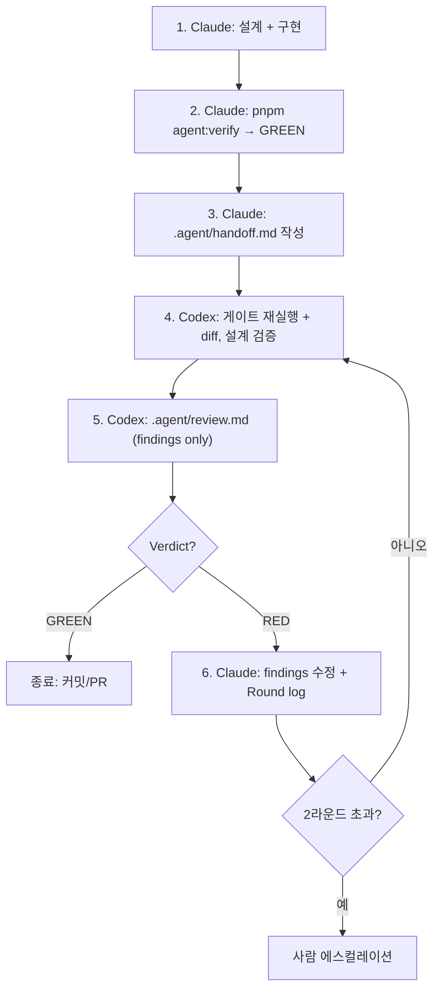

Claude가 기능을 구현하고 "테스트 통과했고, 문제없습니다"라고 보고합니다. 그 말을 누가 검증하죠?

같은 모델이 만들고 스스로 검증하면 같은 맹점을 두 번 통과시킵니다. 사람 조직이 코드 리뷰로 푼 문제가 에이전트 파이프라인에서 그대로 재발하고 있는데, 정작 해법은 옮겨오지 않았습니다.

## 1. 왜 교차검증인가

AI 코딩 에이전트로 개발하다 보면 묘한 불안이 남습니다. 구현도 에이전트가 했고 "문제없다"는 보고도 같은 에이전트가 했습니다. 검증한 주체가 작성한 주체와 같다면, 그 보고는 자기확신에 가깝습니다.

사람 조직은 이 문제를 오래전에 풀었습니다. 코드 리뷰입니다. 작성자가 아닌 사람이 diff를 보고, PR 승인자와 작성자를 나눕니다. 이유는 단순합니다.

- 작성자는 자기 가정을 의심하지 못합니다. 설계할 때 놓친 엣지케이스는 검증할 때도 똑같이 놓칩니다.
- 같은 컨텍스트를 공유하면 결론도 같아집니다. "이 정도면 되겠지"라고 판단한 근거가 검증 단계에서 그대로 다시 쓰입니다.

AI 에이전트도 마찬가지입니다. 같은 모델, 같은 대화 컨텍스트, 같은 추론 과정 위에서 도는 self-review는 작성할 때의 판단을 한 번 더 따라갈 뿐이라 교차검증이 되지 못합니다. 그래서 목표를 네 가지로 잡았습니다.

| 목표 | 구현 수단 |
| --- | --- |
| 작업 방식 | Claude Code가 설계+구현, Codex가 검증 (다른 모델, 다른 세션) |
| 컨텍스트 유지 | 최소 단위 handoff. 검증자는 대화 히스토리를 못 봄 |
| 기계적 준수 | 공통 검증 스크립트. 두 에이전트가 같은 명령으로 같은 결과 |
| 품질 검증 | findings-only 교차검증 + 수렴 규칙(라운드 상한, 에스컬레이션) |

## 2. 하네스를 지탱하는 5가지 설계 원칙

### 원칙 1. 작성자 ≠ 검증자

역할을 파일 레벨에서 고정합니다. 이 레포는 에이전트별 진입 문서가 나뉘어 있습니다. `CLAUDE.md`는 Claude Code가, `AGENTS.md`는 Codex가 자동 로드합니다. 각 문서에 서로 다른 역할을 적어 두면, 어느 터미널을 열든 그 에이전트는 자기 역할을 알고 시작합니다.

- `CLAUDE.md`에는 "너는 author다. 구현하고 handoff를 써라. self-certify 금지."
- `AGENTS.md`에는 "너는 verifier다. 검증하고 findings만 보고해라. 코드 수정 금지."

### 원칙 2. 검증자의 입력은 3개로 제한 (독립성 조건)

검증자는 `.agent/handoff.md`, working-tree diff, `pnpm agent:verify` 출력 세 가지만 봅니다. **작성자의 대화 히스토리는 절대 넘기지 않습니다.** 넘기는 순간 작성자의 가정("이건 이래서 괜찮아")을 물려받아 교차검증이 무너집니다. 설계 자체를 검증받으려면 handoff의 Design decisions 섹션에 결정과 근거를 적습니다. 검증자는 그 섹션의 결정을 반박해 보는 식으로 설계를 검증합니다.

### 원칙 3. 검증자 프롬프트는 버전관리로 고정

자동화에는 함정이 하나 있습니다. 작성자(Claude)가 검증자(Codex)를 호출한다면, 호출 프롬프트를 작성자가 즉석에서 지을 수 있습니다. "이 부분은 검토하지 마" 같은 조작도 할 수 있게 됩니다. 그래서 **검증자 프롬프트를 스크립트에 박아 git으로 관리**합니다. 작성자는 `pnpm agent:review`를 실행할 수 있을 뿐이고, 프롬프트를 바꾸면 그 변경이 diff에 드러납니다.

### 원칙 4. 기계 게이트는 작성자 책임, 검증자는 재현만

typecheck/lint/test 실패를 검증자가 줍게 하면 검증자 시간이 낭비됩니다. 작성자가 먼저 GREEN을 만들고, 검증자는 같은 명령을 다시 실행해 재현만 확인한 뒤 남은 시간을 semantic 검증(설계 결함, 엣지케이스, 규칙 위반, 회귀 위험)에 씁니다.

### 원칙 5. 루프는 반드시 수렴해야 한다

에이전트 둘이 마주 보면 끝없이 주고받을 수 있습니다. 그래서 수렴 장치를 셋 뒀습니다.

- handoff의 Out of scope 목록에 알고도 안 한 것을 적으면 검증자는 다시 지적하지 않습니다. 단, 목록은 Round 1 시점으로 고정합니다. 이후 라운드에 항목을 추가해 finding을 무력화하는 꼼수는 그 자체가 S2 finding입니다.
- verdict는 심각도로 정합니다. 심각도는 S1(correctness), S2(규칙 위반, 위험), S3(개선) 세 단계입니다. **게이트가 전부 pass이고 S1, S2가 없으면 GREEN**이라, S3만 남으면 GREEN으로 끝납니다.
- 라운드 상한은 2입니다. 2라운드 후에도 RED면 사람에게 넘깁니다. 반박은 Round log에 기록만 하고, 미해결 분쟁은 사람이 판단합니다.

## 3. 무엇을 만들었나

### 3-1. 전체 구성 (12개 파일)

| 파일 | 역할 |
| --- | --- |
| `docs/agent-harness.md` | 프로토콜 명세(8단계 루프, 수렴 규칙, 게이트 정의) |
| `docs/agent-handoff-template.md` | 작성자가 검증자에게 넘기는 인수인계 양식 |
| `docs/agent-review-template.md` | 검증자 보고 양식 (findings-only) |
| `scripts/agent-verify.mjs` | 공통 기계 게이트 4종 (`pnpm agent:verify`) |
| `scripts/agent-codex-review.mjs` | 고정 프롬프트로 Codex 호출 (`pnpm agent:review`) |
| `CLAUDE.md` / `AGENTS.md` / `core-standards.mdc` | author/verifier 역할 고정, 세 문서를 같은 내용으로 동기화 |
| `.gitignore`, `.agent/` | 작업 중인 handoff, review 파일은 커밋하지 않음 (태스크마다 덮어씀) |

### 3-2. 표준 작업 루프



4단계에서 6단계를 거쳐 다시 4단계로 돌아오는 루프는 사람 없이 돌 수 있습니다. Claude가 handoff 작성 직후 `pnpm agent:review`를 실행하면 Codex가 검증하고, exit code(0=GREEN, 2=RED)로 다음 행동이 정해집니다.

### 3-3. 기계 게이트 (`agent-verify.mjs`)

작성자와 검증자가 같은 명령을 실행하므로 "내 환경에선 됐는데"라는 말이 나오기 어렵습니다.

| 게이트 | 내용 | 설계 포인트 |
| --- | --- | --- |
| typecheck | `next typegen` 후 `tsc --noEmit` | route 타입을 먼저 재생성해 `.next` stale 에러를 없애고, 남는 에러는 전부 실패 |
| eslint | 변경 파일만 lint | 기준은 `AGENT_VERIFY_BASE`. handoff의 Base ref와 일치해야 함 |
| unit | `vitest run --project unit` | |
| i18n | `build-en --check` | en.json이 코드의 `t()` 호출과 일치하는지 |

typecheck 게이트에는 사연이 있습니다(6장 참조). 처음엔 `.next/` 경로의 에러를 문자열 필터로 무시했는데, 교차검증에서 결함 두 개가 확인됐습니다. 하나는 tsc가 크래시하면 에러 라인이 0개라 pass로 잘못 판정하는 것(false GREEN)이고, 다른 하나는 `.next/types`에 stale 캐시와 함께 진짜 route 타입 에러도 섞여 있어 필터가 신호까지 삼키는 것이었습니다.

```javascript
function gateTypecheck() {
  // Regenerate Next.js route types first: stale .next/types validators (deleted
  // or renamed routes) otherwise surface as phantom errors, and real route-type
  // errors must NOT be filtered out.
  const typegen = runCommand("pnpm", ["exec", "next", "typegen"]);
  if (typegen.exitCode !== 0) {
    return { status: "fail", detail: `next typegen failed (exit ${typegen.exitCode})...` };
  }
  const { exitCode, output } = runCommand("pnpm", ["exec", "tsc", "--noEmit"]);
  if (exitCode === 0) {
    return { status: "pass", detail: "no type errors (route types regenerated first)" };
  }
  const errorLines = output.split("\n").filter(line => /error TS\d+/.test(line));
  if (errorLines.length > 0) {
    return { status: "fail", detail: `${errorLines.length} error(s)\n...` };
  }
  // Nonzero exit without diagnostics = tsc crashed or never ran. Never a pass.
  return { status: "fail", detail: `tsc exited ${exitCode} without diagnostics...` };
}
```

eslint 게이트도 비슷했습니다. 처음엔 base ref를 못 찾으면 skip으로 처리했는데, skip이 GREEN에 포함되면 **검증을 못 했는데도 통과**가 됩니다. 그래서 검증할 대상이 없을 때(변경 파일 0개)만 skip으로 두고, 검증을 못 할 때(base ref 부재)는 fail로 바꿨습니다.

```javascript
function gateEslint() {
  let changedFiles;
  try {
    changedFiles = collectChangedLintableFiles();
  } catch {
    // Cannot resolve what changed = cannot verify it. This must be a failure,
    // not a skip. Otherwise a verifier without the base ref fetched would
    // reproduce GREEN without ever linting.
    return { status: "fail", detail: `base ref "${BASE_REF}" not found ...` };
  }
  if (changedFiles.length === 0) {
    return { status: "skip", detail: `no lintable files changed vs ${BASE_REF}` };
  }
  const { exitCode, output } = runCommand("pnpm", ["exec", "eslint", ...changedFiles]);
  // ...
}
```

### 3-4. 검증자 자동 호출 (`agent-codex-review.mjs`)

원칙 3(프롬프트 고정)을 구현한 스크립트입니다. Claude가 이 명령을 실행해도 프롬프트는 git이 관리하는 아래 텍스트 그대로 나갑니다.

```javascript
const VERIFIER_PROMPT = `You are the VERIFIER in this repo's agent harness (docs/agent-harness.md).
Your role and constraints are defined in AGENTS.md ("Agent harness: Codex is the verifier").

1. Read ${HANDOFF_PATH} and docs/agent-review-template.md.
2. Run the machine gates with the base ref pinned to the handoff's Base ref:
   AGENT_VERIFY_BASE=<handoff Base ref> pnpm agent:verify
3. Review the working-tree diff against the handoff's base ref
   (git diff <base ref> plus untracked files) for: correctness bugs, project
   rule violations (.cursor/rules, AGENTS.md), regression risk, and weaknesses
   in the handoff's stated design decisions.
4. Do NOT flag anything listed under the handoff's "Out of scope / intended
   decisions" as of Round 1. Later additions to that list do not bind you.
   If the list changed between rounds, report the change itself as S2.
5. Write findings-only output to ${REVIEW_PATH} following the template:
   severity S1/S2/S3 per finding, verdict GREEN or RED on the first lines.
6. Do not modify any file other than ${REVIEW_PATH}. Do not fix code.`;

const result = spawnSync(CODEX_BIN, ["exec", "--sandbox", SANDBOX_MODE, VERIFIER_PROMPT], {
  stdio: "inherit",
});
// ... .agent/review.md 의 verdict 라인을 파싱해 exit code 로 변환
process.exit(verdictLine?.includes("RED") === true ? 2 : 0);
```

handoff가 없으면 실행을 거부하고, Codex CLI가 없으면 설치 안내 후 종료합니다. 실패 경로도 전부 명시적입니다.

### 3-5. 검증자에게 넘기는 유일한 컨텍스트, Handoff

템플릿의 뼈대입니다. 전문은 `docs/agent-handoff-template.md`에 있습니다.

```markdown
# Handoff: <한 줄 요약>
## Task:             원 요청/티켓, Base ref
## Intent:           무엇을 왜 바꿨는지 ("어떻게"는 diff가 말한다)
## Changed files:    파일별 변경 이유
## Design decisions & tradeoffs: 검증자가 도전해야 할 결정들
## Out of scope / intended decisions: flag 금지 목록 (Round 1 고정)
## Verification done by author: AGENT_VERIFY_BASE=<base> pnpm agent:verify → GREEN
## Risk areas:       작성자가 확신 낮은 지점 (검증자 시간을 여기에)
## Round log:        라운드별 수정/반박 기록
```

리뷰 보고는 반대로 최소한만 담습니다. verdict, 게이트 표, findings만 쓰고 칭찬과 diff 재서술은 금지입니다. 지적할 게 없으면 "None." 한 줄로 끝납니다.

## 4. 실제로 어떻게 돌리나

사람이 할 일은 사실상 세 가지입니다.

① [Claude Code] 평소처럼 구현을 지시합니다.

```text
"벤치마크 버전 히스토리에 ○○ 기능 구현해줘"
```

`CLAUDE.md`의 프로토콜에 따라 Claude가 구현하고, `agent:verify`를 GREEN으로 만들고, handoff를 쓴 뒤 (Codex CLI가 있으면) `pnpm agent:review`로 검증을 돌립니다. RED면 고치고 다시 검증해서 최종 verdict를 보고하는 데까지 자동으로 진행합니다.

② [사람] handoff의 Out of scope 섹션만 훑습니다(10초). 여기 적힌 건 검증자가 지적하지 않으므로, 작성자가 결함을 여기에 숨기지 않았는지는 사람이 봐야 합니다.

③ verdict를 확인합니다. GREEN이면 커밋하고 PR을 올립니다. RED가 2라운드 이어지면 `.agent/review.md`의 미해결 findings를 직접 읽고 결정합니다.

수동으로 돌릴 때는 Codex 터미널에서 새 세션을 열고, 대화 히스토리는 공유하지 않습니다.

```bash
# 기계 게이트만
pnpm agent:verify
AGENT_VERIFY_BASE=origin/main pnpm agent:verify   # base ref 는 handoff 와 일치

# Codex 검증 (고정 프롬프트)
pnpm agent:review   # exit 0 = GREEN, 2 = RED, 1 = 실행 실패
```

전제 조건은 하나입니다. `npm i -g @openai/codex`로 설치하고 `codex login`으로 로그인해 두면 됩니다.

오타나 한 파일짜리 사소한 변경은 하네스를 건너뛰고 handoff 없이 `pnpm agent:verify`만 돌립니다. 하네스는 여러 파일에 걸친 기능 변경, 회귀 위험이 있는 QA 수정, 설정 변경에 씁니다.

## 5. 이 하네스가 안 통하는 경우

검증자도 같은 종류의 실수를 합니다. 모델이 다르면 맹점이 다를 거라는 게 이 설계의 전제인데, 완전히 다르지는 않습니다. 두 모델 모두 비슷한 코드로 학습했을 테니 흔히 이렇게 쓴다는 관성도 비슷합니다. 원칙 1이 걸러내는 건 컨텍스트 공유에서 오는 동조까지이고, 모델 자체의 편향은 그대로 남습니다.

handoff 품질이 상한을 정합니다. 검증자가 맥락을 얻는 곳은 handoff와 diff뿐이라, 작성자가 Risk areas를 대충 쓰면 검증자는 엉뚱한 데를 봅니다. 독립성을 지키려고 컨텍스트를 끊었는데, 그 대가로 **작성자가 무엇을 넘길지 고를 권한**이 생깁니다. 원칙 5에서 Out of scope 목록을 Round 1에 고정한 게 이 구멍을 부분적으로 막지만, 완전히 막지는 못합니다.

기계 게이트가 없는 변경에는 효용이 낮습니다. typecheck, lint, test가 잡아주는 게 없는 작업에서는 검증자가 판단할 근거가 얇습니다. 문서 수정, 설정값 조정, UI 문구 같은 것들입니다. 이럴 때는 라운드만 돌고 findings가 잘 나오지 않습니다.

비용이 두 배입니다. 같은 작업에 에이전트 세션이 둘 돌아갑니다. 모든 변경에 이걸 태우면 감당이 안 됩니다. 지금은 기계 게이트가 의미 있고 되돌리기 어려운 변경에만 붙이고 있는데, 그 기준선 자체가 아직 감입니다.

## 6. 하네스가 첫날 자기 자신을 검증했다

이 하네스의 첫 검증 대상은 **하네스 자신**이었습니다. 구축 직후 산출물 전체(문서 3종, 스크립트, 프로토콜 섹션)를 4개 관점(일관성, 스크립트 정합, 프로토콜 건전성, 레포 규칙 준수)으로 나눠 에이전트 24개에게 교차검증시켰습니다. 발견된 주장마다 반박만 맡는 에이전트를 붙였고, 반박을 견딘 것만 confirmed로 채택했습니다. confirmed는 12건이었습니다.

| 심각도 | 발견 | 수정 |
| --- | --- | --- |
| S1 | typecheck 게이트가 tsc 크래시 때 에러 라인 0개를 pass로 판정 (false GREEN) | 진단 없는 비정상 종료는 무조건 fail |
| S2 | `.next` 필터가 진짜 route 타입 에러까지 삼킴 | `next typegen`(0.9초)을 먼저 실행해 필터 자체 제거 |
| S2 | handoff의 Base ref와 게이트의 base ref가 조용히 어긋날 수 있음 | 템플릿, 프롬프트, 문서 전부에 base ref 고정 지시 |
| S2 | 작성자가 finding을 out-of-scope 목록으로 옮겨 무력화 가능 | Round 1 고정 + 목록 변경 자체를 S2로 보고 |
| S2 | 에스컬레이션 규칙 2개가 서로 모순 (한쪽은 발동 불가능) | 단일 규칙으로 통합, 반박은 Round log에 |
| S3 | base ref 없으면 eslint skip인데 verdict는 GREEN | skip을 fail로 강화 |

S1은 검증 도구가 검증에 실패했다는 사실을 말하지 못하는 버그였습니다. 작성자인 저는 통과 경로만 테스트했고, 크래시 경로는 생각하지 못했습니다. 원칙 1에서 말한 바로 그 맹점이고, 교차검증이 없었다면 조용히 살아남았을 코드입니다.

덤도 있었습니다. `pnpm agent:verify`의 첫 실행이 RED였는데, 격리 worktree로 확인해 보니 작업 브랜치에 이미 있던 유닛 테스트 실패 4건을 게이트가 드러낸 것이었습니다.

검증자가 얼마나 똑똑한지는 생각보다 덜 중요했습니다. 제가 보기에 12건을 찾아낸 건 검증자가 작성자와 같은 컨텍스트를 보지 않았기 때문입니다.

다음 단계는 이 루프를 실전 기능 개발에 태우면서 handoff 양식과 skip 기준을 다듬고, CI에서 `agent:verify`를 PR 필수 검사로 올리는 것입니다.

> **후기 (2026-09):** 이 글의 하네스는 레포 안의 파일 12개였습니다. 두 달 뒤 사내 NPM 패키지 `@datumo/agent-harness`로 분리해 front와 admin 두 레포에서 같은 버전을 쓰고 있습니다. 설계 단계에서도 검증자를 한 번 거치는 Plan/Post 하이브리드가 됐고, 규칙 파일을 여러 레포에 뿌릴 때 로컬 수정을 덮어쓰지 않고 diff를 먼저 보여주는 sync가 붙었습니다. 저장소는 사내 비공개입니다.

## 참고

- [Anthropic: Claude Code 서브에이전트 문서](https://code.claude.com/docs/en/sub-agents)
- [OpenAI Codex CLI](https://github.com/openai/codex)
- [Google: Modern Code Review: A Case Study at Google](https://research.google/pubs/modern-code-review-a-case-study-at-google/)
- [SmartBear: Code Review 연구(Cisco 사례)](https://smartbear.com/learn/code-review/best-practices-for-peer-code-review/)

{/* 이미지 체크리스트
IMG-01 [내가 캡처] agent:verify 실행 결과, 첫 실행 RED 화면: 미완료
         의도: "도구가 배포 첫날 밥값을 했다"의 실물 증거
IMG-02 [mermaid로 대체 검토] 작성자, handoff, 검증자, Round log로 이어지는 루프
*/}
