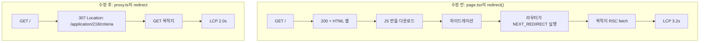

Sentry Web Vitals를 열었더니 랜딩 `/`의 LCP p75가 **5.3초**였습니다. 이 페이지는 아무것도 그리지 않습니다. 로그인한 사용자를 마지막에 보던 애플리케이션으로 보내는 게 전부입니다. 그런 페이지의 LCP가 앱에서 가장 느렸습니다.

코드를 열어보니 주석이 이렇게 적혀 있었습니다. *"Resolves the landing application on the server and redirects before any client JS ships."* 서버에서 리다이렉트하니 클라이언트 JS가 나가기 전에 끝난다는 뜻입니다. 제가 쓴 주석입니다. 측정은 다르게 말하고 있었고, 둘 중 하나는 틀렸습니다.

---

## 1. 주석은 서버 리다이렉트라고 했다

수정 전 `(eval)/page.tsx`는 이렇게 생겼습니다.

```tsx
export default async function EvalHomeRedirectPage() {
  const { applications } = await getEvalApplicationLayoutContext();

  if (applications == null) {
    return <EvalHomeClientRedirect />;
  }

  const cookieStore = await cookies();
  const lastApplicationId = parseLastApplicationIdCookieValue(
    cookieStore.get(LAST_APPLICATION_ID_COOKIE_NAME)?.value,
  );
  const isLastApplicationActive =
    lastApplicationId != null &&
    applications.some(application => String(application.id) === lastApplicationId);
  if (isLastApplicationActive) {
    const locale = await getLocale();
    redirect({ href: buildApplicationCriteriaPath(lastApplicationId), locale });
  }
  // ... 없으면 워크스페이스의 첫 ACTIVE 애플리케이션으로
}
```

Server Component에서 `redirect()`를 호출합니다. 워크스페이스 목록을 받아와서 쿠키의 애플리케이션이 아직 살아 있는지 확인하고, 살아 있으면 그쪽으로 보냅니다. 서버에서 다 하니까 브라우저는 HTML도 받기 전에 이동할 거라고 생각했습니다.

이 판단에는 근거도 있었습니다. 비로그인 사용자를 `/sign-in`으로 보내는 `(eval)/layout.tsx`의 `redirect()`는 실제로 307을 돌려줍니다. 네트워크 탭에서 여러 번 봤습니다. 같은 함수를 한 단계 아래인 page에서 부르면 뭐가 다르겠나 싶었습니다.

---

## 2. 측정이 말한 것

Lighthouse로 `/`를 로그인 상태에서 찍었습니다. 로그인 쿠키와 `lastApplicationId` 쿠키를 심고, 데스크톱 프로필, 콜드 캐시, 5회 median입니다. 네트워크 로그의 앞부분만 보면 이렇습니다.

```text
200  Document  +0ms     /
200  Fetch     +246ms   /application/218/criteria?_rsc=BJvayf8r...
200  Fetch     +250ms   /application/218/criteria?_rsc=5CB68i4p...
```

`/`가 **200**으로 응답합니다. 리다이렉트 카운트는 0입니다. 그리고 246ms 뒤에 목적지의 RSC 페이로드를 `fetch`로 가져옵니다. 서버 리다이렉트는 일어나지 않았고, 클라이언트 라우터가 소프트 내비게이션으로 이동한 겁니다.

FCP는 283ms에 찍혔습니다. `/`의 빈 로딩 화면이 그려진 시점입니다. LCP는 **3,265ms**입니다. 로딩 화면을 받고, JS 번들을 내려받고, 파싱하고, 하이드레이션을 끝내고, 그제야 라우터가 `NEXT_REDIRECT`를 읽어 목적지로 이동하고, 목적지 데이터가 와서 가장 큰 요소가 그려지기까지의 시간입니다. 사용자는 그 3초 동안 스피너를 봅니다.

주석이 틀렸습니다.

---

## 3. page의 redirect()는 왜 307이 될 수 없나

App Router는 세그먼트를 동시에 렌더합니다. `/` 요청이 들어오면 root layout, `(eval)/layout.tsx`, 그리고 `page.tsx`가 함께 렌더를 시작하고, 상위 레이아웃이 준비되는 대로 응답의 앞부분을 먼저 흘려보냅니다. page 컴포넌트가 실행될 시점에는 이미 상태 코드 200과 HTML 앞부분이 나간 뒤입니다.

그 시점에 `redirect()`가 호출되면 Next는 상태 코드를 바꿀 수 없습니다. 대신 RSC 페이로드 안에 `NEXT_REDIRECT;replace;/application/218/criteria;307`을 직렬화해 넣습니다. 이걸 읽고 실행하는 건 브라우저의 라우터입니다. 라우터는 번들이 내려와서 하이드레이션이 끝나야 동작합니다.

여기서 제가 헷갈렸던 지점이 하나 있습니다. 처음엔 page에서 `await`를 하니까 그 사이에 HTML 앞부분이 나가는 거고, `await`를 없애면 되지 않을까 생각했습니다. 그래서 본문이 `redirect(...)` 한 줄뿐인 page를 만들어 봤습니다. 그것도 200이었습니다. page가 무엇을 기다리는지는 상관이 없었습니다. 문제는 **page라는 위치 자체가 HTML 앞부분이 나간 뒤에 실행된다**는 데 있었습니다.

반대로 `(eval)/layout.tsx`의 `redirect()`가 307을 돌려주는 것도 같은 원리입니다. 레이아웃은 먼저 나가는 HTML에 속하기 때문에 그 결정이 상태 코드에 반영될 수 있습니다. 경계는 layout과 page 사이에 있습니다.



그러면 어디서 해야 하나. layout보다 앞에서 실행되는 곳은 Proxy(Next 15까지는 middleware)입니다. 요청이 렌더링에 들어가기 전에 응답을 결정할 수 있습니다.

---

## 4. Proxy로 올리면서 포기한 것

옮기는 코드 자체는 길지 않습니다.

```ts
function resolveLandingRedirect(request) {
  if (request.nextUrl.pathname !== "/") return null;
  if (!isActiveAuthSession(request.auth)) return null;

  const lastApplicationId = parseLastApplicationIdCookieValue(
    request.cookies.get(LAST_APPLICATION_ID_COOKIE_NAME)?.value,
  );
  if (lastApplicationId == null) return null;
  return buildApplicationCriteriaPath(lastApplicationId);
}

export default auth(request => {
  const landingPath = resolveLandingRedirect(request);
  if (landingPath != null) {
    return NextResponse.redirect(new URL(landingPath, request.nextUrl));
  }
  // ...
});
```

대신 세 가지를 정해야 했습니다.

애플리케이션이 아직 살아 있는지는 확인하지 않습니다. page 버전은 워크스페이스 목록을 받아와서 쿠키의 애플리케이션이 ACTIVE인지 검사했습니다. Proxy에서 그걸 하려면 같은 백엔드 요청을 해야 하는데, 그 요청을 기다리면 줄이려던 시간이 다시 늘어납니다. 그래서 쿠키만 봅니다. 쿠키가 낡았으면(그 사이에 애플리케이션이 삭제됐으면) 목적지 페이지의 `ApplicationRouteGuard`가 클라이언트에서 한 번 더 보정합니다. 낡은 쿠키를 가진 사용자가 클라이언트 보정 한 번을 겪는 것과, 돌아오는 모든 사용자가 매번 3초를 기다리는 것 중에 전자를 택했습니다.

쿠키가 없으면 아무것도 하지 않습니다. 첫 방문이거나 저장소를 지운 사용자는 예전처럼 page로 내려가서 워크스페이스 목록 기반으로 갈 곳을 정합니다. 그 경로는 그대로 느립니다. 대신 한 번 어딘가에 들어가면 다음부터는 쿠키가 있습니다.

세션 만료는 layout에 맡깁니다. auth.js는 refresh token이 만료돼도 세션 객체를 돌려줍니다. `session.error = "RefreshTokenExpired"`가 붙어 있을 뿐입니다. 이걸 `session != null`로만 검사하면 만료된 사용자를 애플리케이션 페이지로 보내고, 거기서 layout이 다시 `/sign-in?reason=session_expired`로 튕깁니다. 이동이 한 번 늘고 만료 안내가 늦게 뜹니다. 그래서 layout이 쓰는 것과 같은 `isActiveAuthSession` 판정을 쓰고, 만료면 Proxy는 손대지 않고 layout의 307에 맡깁니다.

나중에 물린 것도 하나 있습니다. `NextResponse.redirect`에 넘기는 URL은 **절대 URL이어야 합니다.** Next가 이 Location을 base 없이 `new NextURL(redirect)`로 파싱하기 때문에, 상대 경로를 넘기면 `TypeError: Invalid URL`이 나고 리다이렉트를 타는 `/` 요청이 전부 500이 됩니다. 이후 다른 작업에서 이 부분을 상대 경로로 바꾼 변경이 들어갔고, 스테이징이 정확히 그렇게 깨져서 되돌렸습니다. 절대 URL의 origin은 브라우저까지 가지 않습니다. Next가 호스트를 비교한 뒤 `getRelativeURL`로 헤더를 다시 써서, 실제로 전송되는 값은 `/application/218/criteria`입니다. Route Handler에는 이 정규화가 없어서 반대로 상대 경로 헬퍼를 써야 합니다. 같은 리다이렉트인데 계층마다 규칙이 다릅니다.

---

## 5. 필드에서는 after를 잴 수 없었다

고치고 배포한 뒤 Sentry에서 `/`의 LCP p75가 얼마로 내려갔는지 보려고 했습니다. 그런데 최근 30일 동안 `/` 라우트의 pageload 트랜잭션이 **1건**이었습니다.

당연한 결과인데 잠깐 헤맸습니다. 307을 받은 브라우저는 `/`를 페이지로 로드하지 않습니다. pageload 트랜잭션은 목적지 라우트 이름으로 찍힙니다. 그 1건은 쿠키가 없어서 page까지 내려간 첫 방문자였습니다. 수정 전 5.3초와 수정 후를 같은 라우트에서 비교할 방법은 애초에 없었습니다.

목적지 페이지의 LCP p75를 돌아온 사용자가 겪는 랜딩 경험으로 볼 수는 있습니다. 하지만 그건 다른 라우트의 다른 숫자이고, 수정 전에도 있던 값입니다. 전후 비교가 아닙니다.

그래서 랩으로 갔습니다. 수정 직전 커밋과 수정 커밋을 각각 빌드해서 같은 조건으로 재는 것입니다.

---

## 6. 수정 전후 빌드를 같은 조건으로

두 빌드는 커밋 하나만 다릅니다. `19d9e7fd6^`과 `19d9e7fd6`. 워크트리로 각각 체크아웃하고 `next build`(standalone)를 돌려 두 서버를 띄웠습니다. 측정은 레포에 있는 Lighthouse 스크립트를 그대로 썼고, `lastApplicationId` 쿠키를 심는 옵션만 덧붙였습니다.

- Lighthouse 13, 데스크톱 프로필. 이 제품 사용자는 데스크톱 브라우저를 씁니다.
- CPU 감속 1배와 3배로 두 번. 측정한 맥의 benchmarkIndex는 약 3,700이고 사용자들이 쓰는 노트북은 1,000~1,500 근처라 3배가 그쪽에 가깝습니다.
- 라우트당 5회, 성능 점수가 median인 회차를 채택.
- 매 회차 HTTP 캐시를 비움. 세션 쿠키와 `lastApplicationId=218`은 CDP로 주입.
- 백엔드는 스테이징. 랩 빌드는 Sentry DSN을 비워 프로덕션 데이터를 오염시키지 않았습니다.

| 변형 | CPU | 성능 점수 | LCP | FCP | 리다이렉트 | 최종 URL |
| --- | --- | --- | --- | --- | --- | --- |
| 수정 전 | 1x | 81 | 3,220ms | 283 | 0 | /application/218/criteria |
| 수정 후 | 1x | 90 | 1,991ms | 292 | 161ms | /application/218/criteria |
| 수정 전 | 3x | 79 | 3,266ms | 302 | 0 | 〃 |
| 수정 후 | 3x | 88 | 2,034ms | 309 | 161ms | 〃 |

같은 걸 두 세션 돌렸고 두 번째 세션 값이 위 표입니다. 첫 세션은 3,265 / 1,939 / 3,265 / 2,046ms로 50ms 안에서 일치했습니다.

랜딩 LCP가 **약 3.2초에서 2.0초로, 1.2~1.3초(38~40%)** 줄었습니다. 성능 점수는 80 언저리에서 90 언저리로 올랐습니다.

**CPU를 3배 느리게 해도 개선폭이 같았습니다.** 수정 전 3,220과 3,266, 수정 후 1,991과 2,034. 병목이 연산이었다면 3배 조건에서 차이가 벌어져야 합니다. 그렇지 않다는 건 이 3초가 CPU 연산보다는 하이드레이션이 끝나기를 기다렸다가 다시 왕복하는 데 쓰였다는 뜻입니다. 3절의 설명과 맞습니다.

### 6-1. 측정도 한 번 헛발질했다

첫 세션에서는 쿠키에 `lastApplicationId=156`을 심었습니다. E2E 설정에 적힌 애플리케이션이라 그걸 썼습니다. 결과를 보니 최종 URL이 218이었습니다. 156은 그 계정이 접근할 수 없는 애플리케이션이었고, 목적지 페이지의 가드가 218로 보정한 겁니다.

그러면 수정 후 1회차는 `/`에서 307을 받아 156 페이지를 로드하고, 가드가 다시 218로 보내는 식으로 이동이 한 번 더 있었어야 합니다. 로그를 보니 정확히 그렇습니다. 수정 후 1회차 성능 점수만 82이고 2~5회차는 90입니다. 1회차에 가드가 쿠키를 218로 덮어썼고, 캐시를 비워도 쿠키는 남기는 설정이라 이후 회차는 218로 곧장 갔습니다. median은 깨끗한 회차에서 뽑혔으니 숫자는 유효했지만, 그걸 확인하기 전까지는 믿을 수 없었습니다. 그래서 218로 두 번째 세션을 돌렸고, 그 값을 표에 썼습니다.

218로 돌린 세션에서도 수정 후 1회차 점수는 80으로 낮았습니다. 이번 원인은 쿠키와 상관없는 standalone 서버의 첫 요청 워밍업이었습니다. 5회 median을 쓰는 이유가 이런 데 있습니다.

### 6-2. 한계

- 랩 값입니다. 필드 p75 5.3초와 같은 잣대가 아닙니다. 필드에서도 같은 원인으로 움직였을 거라고 보지만, 수정 후 필드 값으로 확인하지는 못했습니다.
- 스테이징 백엔드의 지연이 양쪽에 똑같이 들어 있습니다.
- Sentry 클라이언트를 끈 빌드라 프로덕션보다 메인 스레드 비용이 낮습니다. 양쪽 동일 조건입니다.
- 쿠키가 있는 사용자의 경로만 잰 것입니다. 첫 방문자는 예전 경로를 그대로 탑니다.

---

## 7. 서버에서 했는지는 응답 코드로 확인한다

`redirect()`를 서버 코드에서 불렀다는 사실과 브라우저가 3xx를 받았다는 사실은 다른 사실입니다. 앞의 것은 코드를 읽으면 알 수 있고, 뒤의 것은 응답을 봐야 압니다. 저는 앞을 확인하고 뒤를 확인했다고 생각했습니다.

지금은 리다이렉트 위치를 이 기준으로 고릅니다.

| 위치 | 응답 | 언제 쓰나 |
| --- | --- | --- |
| Proxy (`proxy.ts`) | 진짜 3xx | 요청 정보(쿠키, 헤더, 세션)만으로 결정할 수 있을 때 |
| layout.tsx | 진짜 3xx | 인증처럼 레이아웃 단계에서 내릴 결정 |
| page.tsx | 200 + RSC 페이로드 | 렌더 결과에 따라 갈릴 때. 하이드레이션 후 이동을 감수 |

page의 `redirect()`가 나쁜 API라는 얘기는 아닙니다. 데이터를 보고 갈 곳을 정해야 하면 page에서 할 수밖에 없을 때가 있습니다. 다만 그 비용이 번들 다운로드와 하이드레이션이고, 그 비용이 LCP에 그대로 찍힌다는 걸 알고 써야 합니다.

첫 방문자 경로가 남은 과제입니다. 쿠키가 없으면 여전히 page까지 내려가 워크스페이스 목록을 기다립니다. 로그인 성공 응답에서 쿠키를 함께 심으면 첫 방문자도 다음 랜딩부터는 307을 탈 수 있을 것 같은데, 그건 다음에 잽니다.

재현하려면 수정 전후 커밋을 워크트리로 받아 각각 빌드한 뒤 `LH_ROUTES=/ LH_RUNS=5 LH_PROFILE=desktop LH_EXTRA_COOKIES="lastApplicationId=<id>" node scripts/lighthouse-audit.mjs`를 돌립니다.

## 참고

- [Next.js: `redirect` 함수](https://nextjs.org/docs/app/api-reference/functions/redirect)
- [Next.js: Proxy (middleware)](https://nextjs.org/docs/app/api-reference/file-conventions/proxy)
- [Next.js: Streaming과 부분 렌더링](https://nextjs.org/docs/app/getting-started/linking-and-navigating#streaming)
- [web.dev: Largest Contentful Paint](https://web.dev/articles/lcp)
- [Sentry: Web Vitals](https://docs.sentry.io/product/insights/frontend/web-vitals/)
- [Lighthouse: 성능 점수 계산](https://developer.chrome.com/docs/lighthouse/performance/performance-scoring)

{/* 이미지 체크리스트
IMG-01 [내가 캡처] Sentry Web Vitals에서 / 라우트 LCP p75 5.3s가 보이는 화면 : 미완료
         의도: 출발점이 필드 데이터였다는 것
IMG-02 [내가 캡처] 수정 전 네트워크 탭. / 200 다음 _rsc fetch가 오는 순서 : 미완료
         의도: 2절의 로그를 실물로
IMG-03 [내가 캡처] 수정 후 네트워크 탭. / 307 다음 목적지 200 : 미완료
IMG-04 [내가 캡처] Lighthouse 리포트 전후 나란히 (LCP 3.2s / 2.0s) : 미완료
*/}
