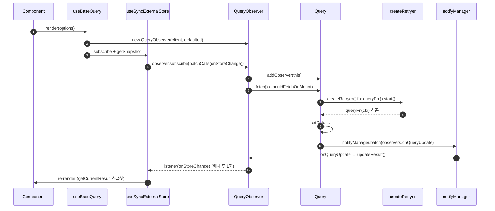

> **TanStack Query 시리즈**
> - [1편: 사용법과 옵션, 그리고 설계 이유](./tanstack-query-guide)
> - **2편 (이 글)**: useQuery 한 줄이 화면에 닿기까지

1편에서는 `staleTime`과 `gcTime`이 왜 다른 축인지, `status`와 `fetchStatus`를 왜 쪼갰는지를 봤습니다. 결론은 v5가 이름의 친절함을 정확함과 맞바꿨다는 것이었습니다.

그런데 옵션의 의미를 알아도 안 풀리는 문제가 있습니다. 리렌더가 왜 이렇게 자주 도는지, 왜 이 컴포넌트만 갱신이 안 되는지, 탭을 옮겼다 오면 왜 요청이 두 번 나가는지. 이런 건 `useQuery`가 안에서 무엇을 부르는지 봐야 답이 됩니다.

이 글은 `useQuery` 한 줄이 화면에 닿기까지의 경로를 `@tanstack/react-query` v5.95.0 소스로 따라갑니다. react-query 어댑터에서 시작해 query-core 엔진까지 내려가고, 마지막에 이 구조가 무엇을 대가로 치렀는지 짚습니다.

## 1. 호출 하나가 지나가는 길

```text
node_modules/.pnpm/@tanstack+react-query@5.95.0_.../node_modules/@tanstack/
├── query-core/src/     ← 핵심 엔진 (QueryClient / QueryCache / Query / retryer / notifyManager)
└── react-query/src/    ← React 훅 (useQuery / useBaseQuery). 단, QueryObserver는 query-core
```

### 전체 흐름

```text
useQuery → useBaseQuery → QueryObserver 구독 → QueryCache(Query 확보) → Query.fetch
         → createRetryer(queryFn 실행) → #dispatch → notifyManager → React 리렌더
```

**마운트(첫 렌더): 데이터를 처음 가져올 때까지**

1. `useQuery(options)`를 호출하면 곧바로 내부의 `useBaseQuery`가 실행됩니다. *(STEP 1, 2)*
2. `new QueryObserver`로 observer를 만든 뒤 `useSyncExternalStore`로 구독합니다. 이 쿼리가 바뀌면 이 컴포넌트를 다시 그려 달라고 React에 등록하는 단계입니다. *(STEP 2, 3)*
3. 구독되는 순간 `observer.onSubscribe()`가 실행되고, `QueryCache.build()`가 `queryKey`에 맞는 `Query`를 있으면 가져오고 없으면 새로 만듭니다(get-or-create). 같은 키를 쓰는 다른 컴포넌트와 캐시를 공유하는 지점이 여기입니다. *(STEP 4, 6)*
4. 데이터가 없거나 오래됐으면(stale) `Query.fetch()`가 시작되고, `createRetryer`가 우리가 넘긴 `queryFn`(실제 API 호출)을 실행합니다. 실패하면 자동으로 재시도합니다. *(STEP 7, 9)*
5. 응답이 도착하면 `Query.#dispatch({ type: 'success' })`로 쿼리의 `state.data`가 채워지고 `status`가 `'success'`로 바뀝니다. *(STEP 8)*
6. `#dispatch`가 구독자 전원에게 알립니다. `notifyManager`가 알림을 모아서 한 번에 흘려보내고, 각 `observer.updateResult()`가 새 `result`를 계산한 뒤 `onStoreChange`를 거쳐 React가 리렌더합니다. *(STEP 10, 4)*

**mutation 후: 바뀐 서버 데이터를 화면에 다시 맞추기**

1. `queryClient.invalidateQueries({ queryKey })`는 먼저 매칭되는 쿼리에 `isInvalidated = true` 표시만 합니다. 이 단계에서는 아직 네트워크 요청을 하지 않습니다. *(STEP 5)*
2. 이어서 `refetchQueries`가 자동으로 실행되어, 그중 지금 화면에 떠 있는 쿼리(구독 중인 active 쿼리)만 골라 다시 `Query.fetch()`를 돌립니다. *(STEP 5)*
3. 그 뒤는 위 마운트 흐름의 4~6번과 같습니다(fetch, 성공, `#dispatch`, 알림 배치, 리렌더).

> 가장 헷갈리는 지점은 두 곳입니다. 첫째, `QueryCache.build`(마운트 3번)는 없을 때만 새로 만들기 때문에 같은 `queryKey`면 캐시 하나를 공유하고, 그래서 중복 요청이 합쳐집니다. 둘째, `invalidate`(mutation 1번)는 오래됐다는 표시만 하고, 실제로 다시 받는(refetch) 건 화면에 떠 있는 쿼리뿐입니다.

| STEP | 모듈 | 이 단계가 하는 일 |
| --- | --- | --- |
| 1 | `useQuery` | 공개 진입점. `QueryObserver`를 꽂아 `useBaseQuery`에 위임 |
| 2 | `useBaseQuery` | observer 생성, 옵션 merge, suspense/error 처리 |
| 3 | `useSyncExternalStore` | observer를 React에 tearing 없이 구독 |
| 4 | `QueryObserver` | 구독 시 fetch 트리거, `result` 조립, 읽은 prop 기준 리렌더 |
| 5 | `QueryClient` | 엔진 진입점. 캐시 보유 + invalidate/refetch API |
| 6 | `QueryCache` | `queryHash`로 `Query` get-or-create |
| 7 | `Query.fetch` | fetch 파이프라인 (dedupe, signal, retryer) |
| 8 | `Query.#dispatch` | reducer로 `state` 갱신 후 observer 알림 |
| 9 | `createRetryer` | queryFn 실행 루프 (재시도, 일시정지, 취소) |
| 10 | `notifyManager` | 알림을 모아 React 리렌더 1회로 배치 |

> STEP 1~4는 react-query 어댑터 층, STEP 5~10은 query-core 엔진 층입니다. 표에서 아래로 내려갈수록 바깥 React에서 안쪽 엔진으로 들어갑니다. STEP 번호는 읽는 순서일 뿐 정확한 호출 순서는 아닙니다. 예를 들어 `createRetryer`(9)는 `Query.fetch`(7) 도중에 돌고, 그 결과가 `#dispatch`(8)로 들어갑니다.

### 통째로 비유하면 식당입니다

> 코드가 막막할 때는 비유가 빠릅니다. TanStack Query를 식당에 빗대 보면 각 모듈의 역할이 한 번에 잡힙니다.

| 식당 | TanStack Query | 하는 일 |
| --- | --- | --- |
| 매니저 | `QueryClient` | 전체 운영, 지시 ("이거 다시 만들어 / 취소해") |
| 주방 선반 | `QueryCache` | 만든 요리(데이터)를 `queryKey` 라벨 붙여 보관 |
| 요리 1접시 + 레시피 | `Query` | 특정 데이터 1개 + 가져오는 법(`queryFn`), 상태 |
| 주문한 손님 테이블 | `QueryObserver` | "이 요리 나오면 알려줘" 구독 (컴포넌트당 1테이블) |
| 요리사 | `queryFn` | 실제로 데이터를 만들어 옴 (API 호출) |
| 다시 요리 | `createRetryer` | 실패하면 잠깐 쉬었다 다시 시도 |
| 한꺼번에 서빙 | `notifyManager` | 여러 변경을 모아 화면 갱신 1번으로 |
| 신선도 유효시간 | `staleTime` | 이 시간 안엔 다시 안 만들고 선반 것 그대로 제공 |
| 선반 비우기 | `gcTime` | 손님(구독자) 다 떠나도 잠깐 뒀다가 치움 |

---

### react-query 어댑터 (STEP 1~4)

#### STEP 1. `useQuery`: 진입점 (얇은 위임, 가볍게 훑기)

```typescript
// react-query/src/useQuery.ts
export function useQuery<...>(
  options: DefinedInitialDataOptions<...>,   // ① initialData 있음
  queryClient?: QueryClient,
): DefinedUseQueryResult<NoInfer<TData>, TError>      //    → data: TData (non-null)

export function useQuery<...>(
  options: UndefinedInitialDataOptions<...>, // ② initialData 없음
  queryClient?: QueryClient,
): UseQueryResult<NoInfer<TData>, TError>             //    → data: TData | undefined

// 실제 런타임 본문은 단 한 줄
export function useQuery(options: UseQueryOptions, queryClient?: QueryClient) {
  return useBaseQuery(options, QueryObserver, queryClient)
}
```

`useQuery`는 로직이 거의 없는 얇은 위임자입니다. 타입 오버로드(`initialData` 유무로 `data` 타입 분기)와 `QueryObserver` 주입만 하고 끝납니다. 실제 동작은 STEP 2부터입니다. `useInfiniteQuery`, `useSuspenseQuery`도 같은 `useBaseQuery`에 다른 Observer만 넣어 그대로 재사용합니다.

#### STEP 2. `useBaseQuery`: React와 core 연결의 심장

```typescript
// react-query/src/useBaseQuery.ts
export function useBaseQuery(options, Observer, queryClient?) {
  const isRestoring = useIsRestoring()
  const errorResetBoundary = useQueryErrorResetBoundary()
  const client = useQueryClient(queryClient)
  const defaultedOptions = client.defaultQueryOptions(options)   // ① 기본값 merge + queryHash 계산

  // ② 구독 전에 optimistic 플래그를 먼저 세팅 (fetching 상태를 선반영)
  defaultedOptions._optimisticResults = isRestoring ? 'isRestoring' : 'optimistic'

  // ③ observer 생성 "이전"에 새 캐시 엔트리 여부 확인 (observer 생성이 캐시 엔트리를 만들기 때문)
  const isNewCacheEntry = !client.getQueryCache().get(defaultedOptions.queryHash)

  // ④ 컴포넌트당 observer 1개: useState 초기화 함수로 최초 1회만 생성, 리렌더에도 동일 인스턴스
  const [observer] = React.useState(
    () => new Observer(client, defaultedOptions),
  )

  // ⑤ useSyncExternalStore 호출 "전"에 스냅샷을 미리 계산 (주석에 must be 명시)
  const result = observer.getOptimisticResult(defaultedOptions)

  // ⑥ 외부 스토어(observer) 구독
  const shouldSubscribe = !isRestoring && options.subscribed !== false
  React.useSyncExternalStore(
    React.useCallback(
      (onStoreChange) => {
        const unsubscribe = shouldSubscribe
          ? observer.subscribe(notifyManager.batchCalls(onStoreChange)) // 여러 알림을 묶어서 한 번에 (리렌더 1번으로 합치기)
          : noop
        observer.updateResult() // 생성~구독 사이 누락분 보정
        return unsubscribe
      },
      [observer, shouldSubscribe],
    ),
    () => observer.getCurrentResult(),  // getSnapshot      (CSR)
    () => observer.getCurrentResult(),  // getServerSnapshot (SSR)
  )

  // ⑦ 옵션 변경은 effect에서 동기화 (렌더 중 setState 금지 규칙 준수)
  React.useEffect(() => {
    observer.setOptions(defaultedOptions)
  }, [defaultedOptions, observer])

  // ⑧ Suspense: 아직 데이터 없으면 promise를 throw → 가장 가까운 <Suspense> 가 잡음
  if (shouldSuspend(defaultedOptions, result)) {
    throw fetchOptimistic(defaultedOptions, observer, errorResetBoundary)
  }
  // ⑨ Error Boundary: throwOnError 조건 충족 시 error throw
  if (getHasError({ result, errorResetBoundary, throwOnError, query, suspense })) {
    throw result.error
  }

  // ⑩ notifyOnChangeProps 미설정 → trackResult(Proxy)로 "읽은 prop만 추적" 후 반환
  return !defaultedOptions.notifyOnChangeProps
    ? observer.trackResult(result)
    : result
}
```

> 왜 `useState(() => new Observer())`일까요? observer는 컴포넌트 인스턴스가 살아 있는 동안 유지되어야 하는 가변 객체입니다. `useMemo`는 React가 캐시를 버리면 다시 만들어질 수 있어서 맞지 않고, 초기화 함수를 넘긴 `useState`는 한 번만 생성되는 것을 보장합니다.

> **이 글에서 제일 중요한 함수입니다.** `useQuery`가 왜 이렇게 동작하는지 궁금할 때 답은 대부분 이 함수에 있습니다. 옵션 정규화, observer 수명 관리, `useSyncExternalStore` 구독, Suspense/에러 throw, `trackResult` 리렌더 최적화를 이 함수 하나가 모두 맡습니다.

```text
컴포넌트 렌더 시작
│
├─ ① 옵션에 기본값 채우기
├─ ② "fetching 중" 플래그 살짝 켜기
├─ ③ 새 캐시 엔트리인지 표시
├─ ④ Observer 인스턴스 확보 (첫 렌더면 생성, 이후는 재사용)
├─ ⑤ 일단 현재 결과 한 번 찍기
├─ ⑥ React한테 "Observer 변하면 알려줘" 등록
├─ ⑦ (렌더 끝난 후) Observer에게 새 옵션 알려주기
├─ ⑧ Suspense 써야 하면 promise throw
├─ ⑨ Error Boundary 써야 하면 error throw
└─ ⑩ Proxy 씌운 결과 반환
↓
```

코드에서 꼭 볼 곳은 두 줄입니다. `useState(() => new Observer())`로 컴포넌트마다 Observer를 하나씩 두고, 그 Observer를 `useSyncExternalStore(subscribe, getCurrentResult, ...)`로 구독합니다. React와 캐시를 잇는 건 이 두 줄이 전부이고, 나머지는 SSR, Suspense, 옵션 변경 같은 예외 처리입니다.

#### STEP 3. `useSyncExternalStore`: 동시성 안전 구독 (React 내장)

> React 바깥의 값(쿼리 캐시)이 바뀌면 이 컴포넌트를 다시 그리도록 안전하게 연결해 주는 React 공식 훅입니다. 예전에는 이벤트를 직접 구독하고 `setState`를 부르는 식이었지만 동시성 렌더링에서 깨지기 쉬워서, React가 표준 훅으로 만들었습니다.

v5는 v4의 `useState + useEffect` 구독을 버리고 React 18 내장 훅 `useSyncExternalStore(subscribe, getSnapshot, getServerSnapshot?)`를 사용합니다.

```typescript
React.useSyncExternalStore(
  /* subscribe         */ useCallback((onStoreChange) => observer.subscribe(
                            notifyManager.batchCalls(onStoreChange)), [observer, shouldSubscribe]),
  /* getSnapshot       */ () => observer.getCurrentResult(),
  /* getServerSnapshot */ () => observer.getCurrentResult(),
)
```

- React 18 동시성 렌더링에서 외부 스토어(여기서는 `QueryObserver`/`QueryCache`)는 React state가 아니어서, 일반 구독으로는 한 렌더 트리 안에서 서로 다른 스냅샷을 보는 tearing(찢김)이 생길 수 있습니다. `useSyncExternalStore`는 렌더 직전에 스냅샷을 동기적으로 다시 읽어 일관성을 보장합니다.
- `getSnapshot`은 반드시 안정적인 참조를 반환해야 합니다. `getCurrentResult()`는 `QueryObserver`가 `shallowEqualObjects`로 메모이즈한 `#currentResult`를 그대로 돌려주므로(값이 안 바뀌면 같은 참조) 무한 리렌더가 생기지 않습니다.
- `subscribe` 함수의 참조가 바뀌면 React가 다시 구독하므로, `useCallback` 의존성을 `[observer, shouldSubscribe]`로 최소화합니다.
- `useMutation`, `useIsFetching`, `useMutationState`, `useQueries`도 같은 훅을 씁니다. (v4는 React 17 호환용 `use-sync-external-store/shim`을 쓰고, v5.95는 `React.useSyncExternalStore`를 직접 호출합니다.)

#### STEP 4. `QueryObserver`: 구독, result 조립, 리렌더 (useSyncExternalStore가 구독하는 것)

구독과 해제를 처리하는 부분이 `query.fetch`의 트리거 지점입니다.

```typescript
// queryObserver.ts
protected onSubscribe(): void {
  if (this.listeners.size === 1) {          // 첫 구독자일 때만
    this.#currentQuery.addObserver(this)    // Query.observers 에 등록 → GC 타이머 해제
    if (shouldFetchOnMount(this.#currentQuery, this.options)) {
      this.#executeFetch()                  // 마운트 시 fetch 필요하면 실행
    } else {
      this.updateResult()
    }
    this.#updateTimers()                    // staleTimeout + refetchInterval 세팅
  }
}
protected onUnsubscribe(): void {
  if (!this.hasListeners()) this.destroy()  // 마지막 구독자 떠나면 정리 → Query.removeObserver → GC 예약
}
```

`createResult()`는 우리가 보는 `result` 객체를 조립합니다.

```typescript
// 1) placeholderData: data 없고 pending 일 때만 적용 (이전 placeholder 메모이즈)
// 2) select: data 있을 때 변환 + 이전 결과와 메모이즈 (select === this.#selectFn && data 동일 → 재사용)
// 3) 최종 파생 플래그 계산
const isFetching = newState.fetchStatus === 'fetching'
const isPending  = status === 'pending'
const isLoading  = isPending && isFetching            // 최초 로딩
const result = {
  status, fetchStatus: newState.fetchStatus,
  isPending, isSuccess: status==='success', isError,
  isLoading,
  isRefetching: isFetching && !isPending,             // 백그라운드 재요청
  isLoadingError: isError && !hasData,
  isRefetchError: isError && hasData,
  isStale: isStale(query, options),
  isPlaceholderData, data, error, refetch: this.refetch, /* ... */
}
```

`updateResult()`와 `shouldNotifyListeners()`는 리렌더가 필요한 경우만 골라냅니다.

```typescript
updateResult(): void {
  const nextResult = this.createResult(this.#currentQuery, this.options)
  if (shallowEqualObjects(nextResult, prevResult)) return  // 변화 없으면 알림 X
  this.#currentResult = nextResult
  // notifyOnChangeProps / trackedProps 에 포함된 prop이 실제로 바뀌었을 때만 listener 호출
  this.#notify({ listeners: shouldNotifyListeners() })
}
```

`trackResult()`는 컴포넌트가 읽은 prop만 추적하도록 결과를 Proxy로 감쌉니다.

```typescript
trackResult(result) {
  return new Proxy(result, {
    get: (target, key) => {
      this.trackProp(key)            // 컴포넌트가 result.data 를 읽으면 'data'를 추적 대상에 추가
      return Reflect.get(target, key)
    },
  })
}
```

> 컴포넌트가 `data`만 구조분해하면 `#trackedProps = {data}`가 되고, 이후 `isStale`/`failureCount` 등이 바뀌어도 리렌더하지 않습니다.

파일 하단에는 fetch/stale을 판단하는 헬퍼가 모여 있습니다. 옵션의 의미는 여기서 정해집니다.

```typescript
// 4개 헬퍼 = "지금 이 쿼리, 데이터를 받아야 하나?"를 판단 (맨 아래 isStale가 가장 기본 단위)

// ① 데이터를 '처음' 받아야 하나? → 아직 데이터가 한 번도 없을 때
function shouldLoadOnMount(query, options) {
  return (
    resolveEnabled(options.enabled, query) !== false &&   // enabled:false면 제외
    query.state.data === undefined &&                     // 데이터가 아예 없고
    !(query.state.status === 'error' && options.retryOnMount === false) // (에러 + 재시도금지)만 아니면
  )
}

// ② 마운트 때 fetch할까? → 데이터 없으면 받고(①), 있어도 refetchOnMount 규칙상 필요하면 받음
function shouldFetchOnMount(query, options) {
  return (
    shouldLoadOnMount(query, options) ||                  // 데이터 없음 → 무조건 받기
    (query.state.data !== undefined &&                    // 데이터는 있지만
      shouldFetchOn(query, options, options.refetchOnMount)) // refetchOnMount 규칙상 받아야 하면
  )
}

// ③ refetchOnMount / refetchOnWindowFocus / refetchOnReconnect 공통 규칙
function shouldFetchOn(query, options, field) {
  if (resolveEnabled(options.enabled, query) !== false &&        // 꺼져 있으면 안 받고
      resolveStaleTime(options.staleTime, query) !== 'static') { // staleTime:'static'이면 영영 안 받음
    const value = typeof field === 'function' ? field(query) : field
    return value === 'always'                           // 'always' → 신선해도 무조건
      || (value !== false && isStale(query, options))   // 그 외 → '낡았을 때(stale)'만
  }
  return false
}

// ④ 기본 단위: "이 데이터 낡았나?" → 위 헬퍼들이 전부 이걸 사용
function isStale(query, options) {
  return (
    resolveEnabled(options.enabled, query) !== false &&             // 꺼져 있으면 stale 아님
    query.isStaleByTime(resolveStaleTime(options.staleTime, query)) // staleTime 지났으면 true (데이터 없음, invalidate도 true)
  )
}
```

| 함수 | 쉽게 말하면 | 언제 `true`인가 |
| --- | --- | --- |
| `isStale` | "이 데이터 낡았어?" | staleTime이 지났거나, 데이터가 없거나, invalidate됨 |
| `shouldLoadOnMount` | "데이터가 아예 없어서 처음 받아야 해?" | 사실상 데이터가 `undefined`일 때 |
| `shouldFetchOnMount` | "마운트했을 때 받을까?" | 데이터가 없으면 무조건, 있으면 `refetchOnMount`에 따라 |
| `shouldFetchOn` | mount/focus/reconnect 공통 규칙 | `'always'`면 무조건, 아니면 낡았을 때만 |

> 데이터가 없으면 무조건 받고, 데이터가 있으면 낡았고(stale) 그 트리거(mount/focus/reconnect)가 켜져 있을 때만 받습니다. `enabled: false`나 `staleTime: 'static'`이면 어느 경우든 받지 않습니다.

polling도 `QueryObserver`의 타이머가 맡습니다.

```typescript
#updateRefetchInterval(nextInterval) {
  this.#refetchIntervalId = timeoutManager.setInterval(() => {
    if (this.options.refetchIntervalInBackground || focusManager.isFocused()) {
      this.#executeFetch()        // 포커스 없으면(백그라운드) refetchIntervalInBackground=true 일 때만
    }
  }, this.#currentRefetchInterval)
}
```

---

### query-core 엔진 (STEP 5~10)

#### STEP 5. `QueryClient`: 최상위 오케스트레이터

앱 전체의 캐시와 기본 옵션, 전역 이벤트를 총괄합니다. 직접 데이터를 들고 있지는 않고, 내부의 `QueryCache`/`MutationCache`에 위임하면서 바깥으로는 `invalidate`, `prefetch`, `setQueryData` 같은 공개 API만 노출합니다.

```typescript
// queryClient.ts: 보유 상태
#queryCache; #mutationCache; #defaultOptions; #queryDefaults; #mutationDefaults; #mountCount
```

`QueryClientProvider`는 `QueryClient` 인스턴스를 React Context에 꽂아 주는 얇은 래퍼입니다. 자식 컴포넌트의 `useQuery`, `useQueryClient`가 이걸로 client를 찾습니다. Provider는 마운트될 때 `client.mount()`, 언마운트될 때 `unmount()`를 호출해 focus/online 같은 전역 이벤트 리스너를 켜고 끕니다. Provider가 여러 개여도 참조 카운트(refcount)로 묶어 실제 등록은 한 번만 하고, 마지막 Provider가 사라질 때 해제합니다.

```typescript
mount(): void {
  this.#mountCount++
  if (this.#mountCount !== 1) return            // 여러 Provider여도 실제 구독은 1회
  this.#unsubscribeFocus = focusManager.subscribe(async (focused) => {
    if (focused) { await this.resumePausedMutations(); this.#queryCache.onFocus() }
  })
  this.#unsubscribeOnline = onlineManager.subscribe(async (online) => {
    if (online) { await this.resumePausedMutations(); this.#queryCache.onOnline() }
  })
}
```

`defaultQueryOptions`는 사용자 옵션에 전역/키별 기본값을 합치고, `queryKey`로 안정적인 `queryHash` 문자열을 계산하고, 다른 옵션에 따라 정해지는 기본값을 채웁니다. 결과 객체에 `_defaulted = true`를 찍어 두어서, 이미 처리된 옵션이 다시 들어와도 같은 결과가 나옵니다(멱등).

```typescript
const defaultedOptions = {
  ...this.#defaultOptions.queries,
  ...this.getQueryDefaults(options.queryKey),   // setQueryDefaults(부분일치) 병합
  ...options,
  _defaulted: true,
}
if (!defaultedOptions.queryHash)
  defaultedOptions.queryHash = hashQueryKeyByOptions(defaultedOptions.queryKey, defaultedOptions)
if (defaultedOptions.throwOnError === undefined)
  defaultedOptions.throwOnError = !!defaultedOptions.suspense  // suspense면 자동 throwOnError
if (defaultedOptions.queryFn === skipToken)
  defaultedOptions.enabled = false                              // skipToken → 비활성
```

`invalidateQueries`는 안에서 `refetchQueries`를 이어 부르는 2단계 구조입니다.

```typescript
invalidateQueries(filters, options = {}) {
  return notifyManager.batch(() => {
    this.#queryCache.findAll(filters).forEach((q) => q.invalidate())  // ① isInvalidated=true 플래그만
    if (filters?.refetchType === 'none') return Promise.resolve()
    return this.refetchQueries(                                       // ② 실제 refetch
      { ...filters, type: filters?.refetchType ?? filters?.type ?? 'active' },
      options,
    )
  })
}
refetchQueries(filters, options = {}) {
  const fetchOptions = { ...options, cancelRefetch: options.cancelRefetch ?? true }
  const promises = notifyManager.batch(() =>
    this.#queryCache.findAll(filters)
      .filter((q) => !q.isDisabled() && !q.isStatic())   // 비활성/static 제외
      .map((q) => {
        let promise = q.fetch(undefined, fetchOptions)
        return q.state.fetchStatus === 'paused' ? Promise.resolve() : promise
      }),
  )
  return Promise.all(promises).then(noop)
}
```

> invalidate가 곧바로 모든 쿼리를 fetch하지는 않습니다. 1단계는 `isInvalidated` 플래그만 켜고, 2단계 `refetchQueries`가 기본값 `type: 'active'`(구독 중인 observer가 있는) 쿼리만 실제로 `fetch`합니다. 화면에 없는 쿼리는 다음 마운트 때 stale로 판정되어 refetch됩니다.

#### STEP 6. `QueryCache`: Query get-or-create

`queryKey`로 캐시를 찾아보고, 있으면 그 Query를 그대로 쓰고 없으면 새로 만들어 등록합니다.

```typescript
// queryCache.ts: Map<queryHash, Query> 한 개가 전부
export class QueryCache extends Subscribable {
  #queries = new Map<string, Query>()

  build(client, options, state?) {
    const queryHash = options.queryHash ?? hashQueryKeyByOptions(options.queryKey, options)
    let query = this.get(queryHash)
    if (!query) {                              // 없을 때만 생성 → 같은 hash = 같은 인스턴스
      query = new Query({
        client, queryKey: options.queryKey, queryHash,
        options: client.defaultQueryOptions(options),
        state, defaultOptions: client.getQueryDefaults(options.queryKey),
      })
      this.add(query)                          // notify({ type: 'added' })
    }
    return query
  }
  // get / getAll / find / findAll(matchQuery 필터) / remove / notify(→notifyManager.batch)
}
```

> `build`의 get-or-create가 요청 dedupe와 캐시 공유의 출발점입니다. 서로 다른 컴포넌트의 두 observer가 같은 `queryKey`를 쓰면 `queryHash`도 같아서 같은 `Query` 인스턴스 하나를 공유합니다.

#### STEP 7. `Query`: state + fetch 파이프라인

하나의 `queryKey`에 1:1로 대응하는 상태 보관소이자 fetch 실행 단위입니다. 모든 상태 변화는 `dispatch(action)`으로 reducer를 거칩니다. `fetch()`는 진행 중인 promise 공유, `createRetryer`로 실행, 결과를 `dispatch`로 반영, observer들에게 통보까지를 한 묶음으로 처리합니다.

```text
fetch() ─→ 진행 중 promise? ──→ 그거 그대로 반환 (중복 제거)
            └ 없으면 createRetryer로 queryFn 실행
                  └ 성공/실패 → dispatch → observers.onQueryUpdate()
```

`extends Removable`이라 gcTime이 지나면 자동으로 제거되도록 예약됩니다. 주요 상태는 `QueryState`에 모여 있습니다.

```typescript
export interface QueryState<TData, TError> {
  data; dataUpdateCount; dataUpdatedAt
  error; errorUpdateCount; errorUpdatedAt
  fetchFailureCount; fetchFailureReason; fetchMeta
  isInvalidated: boolean
  status: 'pending' | 'success' | 'error'      // 데이터 존재 축
  fetchStatus: 'idle' | 'fetching' | 'paused'  // 네트워크 진행 축
}
```

**`fetch()` 파이프라인 (핵심부)**

```typescript
async fetch(options?, fetchOptions?): Promise<TData> {
  // ① dedupe: 이미 fetching이고 retryer가 reject 상태가 아니면 기존 promise 반환
  if (this.state.fetchStatus !== 'idle' && this.#retryer?.status() !== 'rejected') {
    if (this.state.data !== undefined && fetchOptions?.cancelRefetch) this.cancel({ silent: true })
    else if (this.#retryer) { this.#retryer.continueRetry(); return this.#retryer.promise }
  }
  // ② AbortController: signal 게터를 읽는 순간 #abortSignalConsumed = true
  const abortController = new AbortController()
  // ③ queryFn 컨텍스트 구성 { client, queryKey, meta, signal }
  const fetchFn = () => ensureQueryFn(this.options, fetchOptions)(createQueryFnContext())
  // ④ behavior 훅 (infiniteQuery 등)
  this.options.behavior?.onFetch(context, this)
  this.#revertState = this.state                                  // 취소 시 되돌릴 상태 백업
  if (this.state.fetchStatus === 'idle' /* ... */)
    this.#dispatch({ type: 'fetch', meta })                       // → fetchStatus: 'fetching'
  // ⑤ retryer 생성: 콜백들이 모두 #dispatch 로 연결됨
  this.#retryer = createRetryer({
    fn: context.fetchFn,
    onCancel: (e) => { if (e instanceof CancelledError && e.revert) this.setState({ ...this.#revertState, fetchStatus: 'idle' }); abortController.abort() },
    onFail:    (failureCount, error) => this.#dispatch({ type: 'failed', failureCount, error }),
    onPause:   () => this.#dispatch({ type: 'pause' }),
    onContinue:() => this.#dispatch({ type: 'continue' }),
    retry: context.options.retry, retryDelay: context.options.retryDelay, networkMode: context.options.networkMode,
    canRun: () => true,
  })
  try {
    const data = await this.#retryer.start()
    if (data === undefined) throw new Error(`${this.queryHash} data is undefined`)
    this.setData(data)                              // → #dispatch('success')
    this.#cache.config.onSuccess?.(data, this); this.#cache.config.onSettled?.(...)
    return data
  } catch (error) {
    if (error instanceof CancelledError) { /* silent → 새 fetch promise / revert → 이전 data */ }
    this.#dispatch({ type: 'error', error })        // → status:'error', isInvalidated:true
    this.#cache.config.onError?.(error, this); this.#cache.config.onSettled?.(...)
    throw error
  } finally {
    this.scheduleGc()
  }
}
```

> 이 코드에서 꼭 볼 곳은 네 군데입니다. ① 이미 fetching이면 새 요청 대신 기존 promise를 재사용합니다(dedupe). ② `#dispatch({ type: 'fetch' })`로 시작하자마자 `fetching` 상태가 됩니다. ③ 실제 `queryFn` 실행은 `createRetryer(...).start()`로 retryer가 맡습니다(STEP 9). ④ `setData(data)`가 `#dispatch('success')`로 이어지므로 성공이 곧 상태 변경입니다(STEP 8로 연결).

#### STEP 8. `#dispatch`: reducer + 알림 (반응성의 심장)

> 쿼리에 무슨 일이 생기든(`fetch`/`success`/`error`…) `state`는 여기 한 곳을 거쳐 바뀌고, 바뀌면 모든 구독자에게 알림이 갑니다. 화면이 갱신되는 길은 대부분 `#dispatch`를 지납니다.

```typescript
#dispatch(action): void {
  const reducer = (state) => {
    switch (action.type) {
      case 'failed':   return { ...state, fetchFailureCount: action.failureCount, fetchFailureReason: action.error }
      case 'pause':    return { ...state, fetchStatus: 'paused' }
      case 'continue': return { ...state, fetchStatus: 'fetching' }
      case 'fetch':    return { ...state, ...fetchState(state.data, this.options), fetchMeta: action.meta ?? null }
      case 'success':  return { ...state, ...successState(action.data, action.dataUpdatedAt),
                                dataUpdateCount: state.dataUpdateCount + 1,
                                ...(!action.manual && { fetchStatus: 'idle', fetchFailureCount: 0, fetchFailureReason: null }) }
      case 'error':    return { ...state, error: action.error, errorUpdateCount: state.errorUpdateCount + 1,
                                errorUpdatedAt: Date.now(), fetchFailureCount: state.fetchFailureCount + 1,
                                fetchFailureReason: action.error, fetchStatus: 'idle', status: 'error', isInvalidated: true }
      case 'invalidate': return { ...state, isInvalidated: true }
      case 'setState':   return { ...state, ...action.state }
    }
  }
  this.state = reducer(this.state)

  notifyManager.batch(() => {
    this.observers.forEach((observer) => observer.onQueryUpdate())  // ① 모든 observer 갱신
    this.#cache.notify({ query: this, type: 'updated', action })    // ② cache 리스너(devtools 등)
  })
}
```

> 이 함수에서 봐야 할 건 마지막 두 동작입니다. `this.state = reducer(this.state)`로 상태를 새로 만들고, `notifyManager.batch(observers.forEach(onQueryUpdate))`로 구독자 전원에게 알립니다. 위 `switch`는 어떤 필드를 바꾸는지에 대한 세부일 뿐이고, Query 쪽 반응성은 상태 변경과 알림 이 한 쌍이 전부입니다.

```typescript
// fetch/success 액션이 쓰는 부분 상태 헬퍼
export function fetchState(data, options) {
  return {
    fetchFailureCount: 0, fetchFailureReason: null,
    fetchStatus: canFetch(options.networkMode) ? 'fetching' : 'paused',  // 오프라인이면 paused
    ...(data === undefined && { error: null, status: 'pending' }),       // 데이터 없으면 pending
  }
}
```

| action | state 변화 |
| --- | --- |
| `fetch` | `fetchStatus: 'fetching'` (offline이면 `'paused'`), data 없으면 `status: 'pending'` |
| `success` | `data` 저장, `dataUpdateCount++`, `fetchStatus: 'idle'`, `isInvalidated: false` |
| `error` | `status: 'error'`, `errorUpdateCount++`, `fetchStatus: 'idle'`, `isInvalidated: true` |
| `failed` | retry 진행 중 카운트. `fetchFailureCount/Reason` 갱신 (status는 그대로) |
| `pause` / `continue` | `fetchStatus`를 각각 `'paused'`, `'fetching'`으로 전환 (offline/blur) |
| `invalidate` | `isInvalidated: true` (fetch는 아직 안 함) |

#### STEP 9. `createRetryer`: 재시도 / 일시정지 / 취소

> `queryFn`을 실제로 돌리는 작은 실행기입니다. 실패하면 점점 더 긴 간격으로 다시 시도하고, 탭이 백그라운드거나 오프라인이면 멈췄다가 복귀할 때 이어서 합니다.

클래스 대신 클로저로 만든 팩토리입니다. `thenable` 1개와 `start/cancel/continue/...`를 가진 객체를 반환합니다.

```typescript
// retryer.ts
function defaultRetryDelay(failureCount) {
  return Math.min(1000 * 2 ** failureCount, 30000)   // 지수 백오프, 최대 30s
}
export function canFetch(networkMode) {
  return (networkMode ?? 'online') === 'online' ? onlineManager.isOnline() : true
}

export function createRetryer(config) {
  let isRetryCancelled = false, failureCount = 0, continueFn
  const thenable = pendingThenable()

  const canContinue = () =>
    focusManager.isFocused() &&
    (config.networkMode === 'always' || onlineManager.isOnline()) &&
    config.canRun()

  const run = () => {
    if (isResolved()) return
    let promiseOrValue
    try { promiseOrValue = (failureCount === 0 ? config.initialPromise : undefined) ?? config.fn() }
    catch (e) { promiseOrValue = Promise.reject(e) }

    Promise.resolve(promiseOrValue).then(resolve).catch((error) => {
      if (isResolved()) return
      const retry = config.retry ?? (environmentManager.isServer() ? 0 : 3)   // 기본: 서버 0, 클라 3
      const delay = typeof retryDelay === 'function' ? retryDelay(failureCount, error) : retryDelay
      const shouldRetry =
        retry === true ||
        (typeof retry === 'number' && failureCount < retry) ||
        (typeof retry === 'function' && retry(failureCount, error))
      if (isRetryCancelled || !shouldRetry) { reject(error); return }   // 더 안 함
      failureCount++
      config.onFail?.(failureCount, error)
      sleep(delay)
        .then(() => (canContinue() ? undefined : pause()))   // 오프라인/blur면 일시정지
        .then(() => { isRetryCancelled ? reject(error) : run() })
    })
  }
  return { promise: thenable, status: () => thenable.status, cancel, continue, cancelRetry, continueRetry, canStart,
           start: () => { canStart() ? run() : pause().then(run); return thenable } }
}
```

- `pause()`는 `continueFn`을 등록해 둔 Promise를 반환합니다. 포커스나 온라인이 복구되면(`onFocus`/`onOnline`) `continue()`가 이 Promise를 resolve해 `run()`을 재개합니다. `networkMode: 'online'`의 오프라인 대응이 여기서 일어납니다.
- `CancelledError { revert, silent }`는 unmount, queryKey 변경, `cancelQueries` 시 throw됩니다. `silent`면 곧 시작될 새 fetch의 promise를 이어받고, `revert`면 `#revertState`로 복구합니다.

#### STEP 10. `notifyManager`: 리렌더 배치 (싱글톤)

> 알림을 즉시 보내지 않고 잠깐 모았다가 한 번에 보내는 우체통입니다. 덕분에 쿼리 상태가 연달아 여러 번 바뀌어도 화면은 한 번만 다시 그려집니다.

```typescript
// notifyManager.ts
export function createNotifyManager() {
  let queue = [], transactions = 0
  let notifyFn = (cb) => cb()
  let batchNotifyFn = (cb) => cb()
  let scheduleFn = defaultScheduler   // = systemSetTimeoutZero (setTimeout 0)

  const schedule = (cb) => {
    if (transactions) queue.push(cb)                 // 배치 중이면 큐에 모음
    else scheduleFn(() => notifyFn(cb))
  }
  const flush = () => {
    const original = queue; queue = []
    if (original.length) scheduleFn(() => batchNotifyFn(() => original.forEach(notifyFn)))
  }
  return {
    batch: (cb) => {                                 // 중첩 가능 (카운터)
      transactions++
      try { return cb() }
      finally { if (!--transactions) flush() }       // 가장 바깥 batch 종료 시 1회 flush
    },
    batchCalls: (cb) => (...args) => schedule(() => cb(...args)),  // 호출을 큐로 보냄
    setBatchNotifyFunction: (fn) => { batchNotifyFn = fn },        // React 어댑터가 주입
    schedule, setNotifyFunction, setScheduler,
  }
}
export const notifyManager = createNotifyManager()  // 전역 1개
```

> `useBaseQuery`가 `notifyManager.batchCalls(onStoreChange)`로 React 알림을 감싸기 때문에, 한 `#dispatch` 안에서 여러 observer state가 바뀌어도 `transactions` 카운터가 0이 되는 시점에 한 번만 flush되고, React 리렌더도 1 tick으로 묶입니다.

---

### 전체 라이프사이클 시퀀스 (런타임 순서)



**`invalidateQueries({ queryKey: prefix })` 경로**

```text
invalidateQueries → findAll(partialMatchKey) → q.invalidate()  // isInvalidated=true
                 → refetchQueries(type:'active') → q.fetch() → (위 시퀀스 R~Cmp 동일)
```

---

## 2. 내부를 봐야 답이 되는 질문들

### Q1. `useQuery`는 얇은 래퍼라면서 왜 `useBaseQuery` 대신 `useQuery`를 쓰나요?

`useBaseQuery`는 애초에 패키지가 export하지 않는 내부 구현이라 앱에서 import할 수 없습니다. `useQuery`는 ① 공개 진입점이고, ② `QueryObserver`를 대신 꽂아 주며(`useBaseQuery`는 Observer를 직접 넘겨야 하는 인자 3개짜리 함수), ③ `initialData` 유무에 따른 `data` 타입 오버로드를 제공합니다. 같은 `useBaseQuery`를 `useInfiniteQuery`(`InfiniteQueryObserver`), `useSuspenseQuery` 등이 각자 다른 Observer로 재사용합니다. `useBaseQuery`는 부품이고 `useQuery`는 완성품입니다.

### Q2. `useSyncExternalStore`가 도대체 뭐예요?

React 18에 추가된 내장 훅입니다. React state가 아닌 외부 스토어(여기서는 TanStack Query의 캐시/observer)의 값을 React 컴포넌트가 안전하게 구독하게 해 줍니다. 인자는 `subscribe`(변경 알림 등록), `getSnapshot`(현재 값), `getServerSnapshot`(SSR용) 셋입니다. React는 렌더 직전에 `getSnapshot`을 다시 호출해 tearing을 막습니다.

### Q3. tearing(찢김)이 뭐예요?

React 18 동시성 모드에선 한 렌더가 중간에 쪼개져 실행될 수 있는데, 그 사이 외부 데이터가 바뀌면 같은 화면의 컴포넌트 A, B가 서로 다른 값을 보일 수 있습니다. 이 불일치가 tearing입니다. `useSyncExternalStore`는 커밋 직전 스냅샷을 다시 확인해 일관성을 보장합니다.

### Q4. Observer가 뭐고, 왜 컴포넌트당 1개인가요?

Observer 패턴의 구독자입니다. `QueryObserver`는 특정 `Query`(캐시 엔트리)를 지켜보다가 `state`가 바뀌면 `result`를 다시 계산해 컴포넌트에 알립니다. `useQuery`를 한 번 호출하면 `QueryObserver`가 하나 생기고, `useState`로 만들기 때문에 컴포넌트가 살아 있는 동안 같은 인스턴스가 유지됩니다. 여러 컴포넌트가 같은 `queryKey`를 봐도 `Query`는 1개지만 Observer는 각자 따로입니다.

### Q5. reducer / dispatch가 뭐예요? (Redux랑 같은 건가요?)

개념은 같습니다. `dispatch(action)`이 `reducer(state, action)`을 거쳐 새 `state`를 만듭니다. `Query.#dispatch`가 `'fetch'`/`'success'`/`'error'` 같은 action을 받아 `Query.state`를 불변으로 갱신하고, 바로 모든 observer에 알립니다. 다른 점은 전역 스토어 하나 대신 `Query` 인스턴스마다 작은 reducer가 있다는 것입니다.

### Q8. `AbortController` / `signal`은 어디에 쓰여요?

진행 중인 fetch를 취소하는 웹 표준입니다. `Query.fetch`가 `AbortController`를 만들어 queryFn 컨텍스트에 `signal`로 넘깁니다. queryFn이 그 `signal`을 `fetch`에 전달하면 unmount, queryKey 변경, `cancelQueries` 때 요청이 실제로 중단됩니다. (`signal`을 안 읽으면 취소 효과가 없습니다.)

### Q9. `createRetryer`는 왜 class가 아니라 함수(클로저)예요?

상태(`failureCount`, `isRetryCancelled` 등)를 클로저 변수로 가두고 필요한 메서드만 객체로 반환하는 패턴입니다. `new`/`this` 없이 캡슐화되고 인스턴스가 가볍습니다. `Query.fetch()`를 한 번 호출할 때마다 retryer가 하나 생기고 수명이 짧아서 클로저가 적합합니다.

### Q10. `trackResult`의 Proxy는 뭐예요?

자바스크립트 `Proxy`로 `result` 객체 읽기를 가로채, 컴포넌트가 실제로 접근한 속성만 기록합니다(`data`만 구조분해하면 `data`만 추적). 그러면 추적되지 않은 속성(`isStale` 등)이 바뀌어도 리렌더를 건너뜁니다. 따로 설정하지 않아도 걸리는 최적화입니다.

### Q11. `notifyManager.batch`가 React 18 자동 배칭과 뭐가 달라요?

React 자동 배칭은 이벤트 핸들러나 마이크로태스크 안에서 일어난 setState를 묶습니다. `notifyManager`는 그보다 앞 단계에서, 라이브러리 내부에서 발생하는 여러 observer 알림을 모아 한 번에 흘려보내는 큐입니다. 둘이 함께 동작해서 Query state가 여러 번 바뀌어도 React 리렌더는 한 번으로 끝납니다.

### Q12. thenable이 뭐예요?

`.then()`을 가진 Promise-호환 객체입니다. retryer가 직접 만든 `pendingThenable`을 promise처럼 반환해서, 나중에 외부에서 `resolve`/`reject`를 제어할 수 있게 합니다(일반 Promise는 외부에서 resolve 못 함). 일시정지/재개 제어의 핵심입니다.

## 3. 앱 코드와 내부의 대응표

| 앱 코드 | 내부 대응 |
| --- | --- |
| `QueryClient` 기본값 `staleTime: 60_000` | `defaultQueryOptions`에서 `isStaleByTime`으로 |
| `retry: (count, err) => err.status === 401 ? false : count < 3` | `createRetryer`의 `shouldRetry` |
| `enabled: userId > 0` | `resolveEnabled`가 false면 `shouldFetchOnMount`도 false |
| `refetchInterval: 10_000` (user 온라인 상태) | `#computeRefetchInterval()`, setInterval |
| `placeholderData: keepPreviousData` (user 목록 페이지) | `createResult()` placeholder 분기 |
| `invalidateQueries({ queryKey: userQueryKeys.all() })` | `partialMatchKey`, `refetchQueries` |
| SSR `prefetchQuery`, `HydrationBoundary` | `dehydrate`/`hydrate`, `isRestoring` |
| optimistic `updateUser` | `onMutate`에서 `setQueryData`, 실패하면 rollback |

### 난이도별 학습 예시

- 기본: `useUserQuery`. 단일 user fetch, `enabled`
- 중급: `useUserListQuery`. 필터 queryKey, `keepPreviousData`, 페이지네이션
- 고급: `useUsersQueries`. `useQueries`로 여러 user 병렬 fetch
- mutation: `useUpdateUserMutation`. invalidate, optimistic update
- RSC: 서버에서 `prefetchQuery(userQueryKeys.detail(id))` 후 클라이언트 hydrate

---

## 4. 이 구조가 치른 대가

동작은 여기까지입니다. 여기서부터는 그 설계가 무엇을 맞바꿨는지에 대한 제 판단입니다.

첫 번째는 `useSyncExternalStore`로 옮긴 결정입니다. v4는 `useState` + `useEffect` 조합으로 외부 스토어를 구독했습니다. 이 방식은 동시성 렌더링에서 tearing이 날 수 있습니다. 렌더 도중에 스토어가 바뀌면, 먼저 렌더된 컴포넌트와 나중에 렌더된 컴포넌트가 서로 다른 값을 그립니다. `useSyncExternalStore`는 React가 그 일관성을 보장해주는 대신, 구독, 스냅샷, 서버 스냅샷 세 함수를 정확히 맞춰야 하는 제약을 겁니다. 스냅샷이 매번 새 객체를 반환하면 무한 루프가 나니까요.

이건 라이브러리 쪽 복잡도를 올려서 앱 쪽 버그를 없앤 거래입니다. 앱 개발자는 tearing을 몰라도 되지만, 대신 라이브러리 내부는 훨씬 읽기 어려워졌습니다. `QueryObserver`가 결과 객체를 캐싱하고 참조 동등성을 유지하려 애쓰는 코드 상당 부분이 여기서 나옵니다.

두 번째는 Observer를 컴포넌트당 하나 두는 구조입니다. 훅 호출마다 Observer 인스턴스가 하나 생깁니다. 같은 `queryKey`를 열 군데서 쓰면 Query는 하나인데 Observer는 열 개입니다. 구독자 관리 비용이 컴포넌트 수에 비례해 늘어납니다.

대신 이 구조라서 컴포넌트마다 다른 `select`, 다른 `enabled`, 다른 `refetchInterval`을 걸 수 있습니다. Query 하나에 Observer 하나였다면 모든 구독자가 같은 옵션을 공유해야 했을 겁니다. 컴포넌트 수가 수백 개가 되는 화면에서는 이 선택이 비용으로 돌아올 수 있는데, 실제로 그 지점에 도달했다는 얘기는 아직 못 봤습니다.

세 번째는 `trackResult`의 Proxy입니다. 결과 객체를 Proxy로 감싸서 컴포넌트가 실제로 읽은 필드만 추적하고, 그 필드가 바뀔 때만 리렌더합니다. `data`만 읽는 컴포넌트는 `isFetching`이 바뀌어도 안 그려집니다. 영리한 최적화입니다.

대가는 디버깅입니다. 콘솔에 결과를 찍으면 Proxy가 보이고, 구조분해로 꺼내는 순간 추적이 걸립니다. 그래서 이 컴포넌트가 왜 리렌더되는지 추적할 때 원인이 코드에서 잘 안 보입니다. 어딘가에서 `isFetching`을 한 번 읽었기 때문인데, 그 읽기는 조건문 안에 숨어 있을 수도 있습니다. 최적화가 자동으로 걸리는 대신 왜 걸렸는지가 안 보입니다.

네 번째는 `createRetryer`를 클래스 대신 클로저로 만든 것입니다. 재시도 상태(현재 시도 횟수, 일시정지 여부, resolve 핸들)를 클로저에 가둬두고 제어 함수만 노출합니다. 외부에서 내부 상태를 건드릴 방법이 없으니 안전합니다. 대신 인스턴스를 들여다볼 수도 없어서, 재시도가 지금 몇 번째인지 디버거로 확인하기가 어렵습니다.

패턴이 반복됩니다. **v5 내부는 대체로 앱 개발자가 실수할 여지를 없애는 대신, 내부에서 무슨 일이 일어나는지 감추는 방향으로 설계되어 있습니다.** 라이브러리로서는 맞는 방향이라고 생각합니다. 다만 문제가 생겼을 때 감춰진 걸 다시 들춰봐야 하고, 그게 이 글을 쓴 이유이기도 합니다.

## 5. 소스를 읽어도 안 보이는 것

소스를 따라가면 무엇이 언제 호출되는지는 알 수 있지만, 이런 것들은 여전히 모릅니다.

- 실제 성능 특성. Observer가 500개일 때 알림 배칭이 얼마나 걸리는지는 코드를 읽어서 알 수 없습니다. 재봐야 압니다.
- 메모리 사용량. `gcTime` 동안 캐시가 얼마나 차지하는지는 데이터 크기와 쿼리 개수에 달렸습니다.
- 엣지케이스에서의 실제 동작. 오프라인 상태에서 탭을 옮기고 돌아왔을 때 `onlineManager`와 `focusManager`가 어떤 순서로 뜨는지 같은 건, 코드 경로가 여러 갈래라 읽는 것만으로는 확신이 안 섭니다.

그래서 이 글이 줄 수 있는 건 **가설을 세울 근거**까지입니다. 리렌더가 잦으면 Proxy가 추적하는 필드를 의심해 보는 데까지가 소스 지식이 해줄 수 있는 일이고, 그다음은 Devtools와 Profiler의 몫입니다.

실제로 이 지식이 쓰인 자리는 두 곳이었습니다. 하나는 필터를 빠르게 바꿀 때 이전 요청의 응답이 나중에 도착해 새 화면을 덮는 문제였습니다. `Query.fetch`가 queryFn 컨텍스트에 `signal`을 넘긴다는 걸 알고 있어서(Q8), 그 `signal`을 실제 `fetch`까지 전달하도록 API 계층을 고쳐 이전 요청이 취소되게 했습니다. 다른 하나는 mutation 뒤 무효화입니다. `invalidateQueries`가 표시와 refetch 두 단계라는 걸 알면(STEP 5), 화면에 없는 도메인의 쿼리는 `refetchType: 'none'`으로 표시만 해두고 다음 진입 때 받게 할 수 있습니다. 둘 다 문서만 읽고는 확신이 안 서던 것들입니다.

## 6. 이걸 알면 뭐가 달라지나

1편 끝에서 처음부터 내부를 알 필요는 없다고 썼는데, 그 말은 지금도 유효합니다. 이 글의 내용을 몰라도 TanStack Query는 잘 돌아갑니다.

달라지는 건 **문제를 만났을 때의 태도**라고 생각합니다. 내부 모델이 없으면 증상마다 검색해서 나온 처방을 하나씩 시도하게 됩니다. `staleTime`을 늘려보고, `select`를 `useCallback`으로 감싸보고, `structuralSharing`을 꺼보고. 그중 하나가 우연히 들으면 왜 들었는지 모른 채 넘어갑니다.

모델이 있으면 순서가 반대가 됩니다. 리렌더가 잦다면 Observer가 몇 개인지, 어떤 필드를 읽고 있는지, 알림이 어느 배치에 묶이는지를 먼저 확인하고, 그다음에 고칩니다. 시도 횟수가 꼭 줄지는 않지만, 틀렸을 때 왜 틀렸는지는 알게 됩니다.

이 라이브러리를 읽으면서 얻은 게 하나 더 있습니다. 외부 스토어 구독, 참조 동등성으로 리렌더 줄이기, 알림 배칭, 클로저로 상태 감추기 같은 패턴은 TanStack Query에만 있지 않습니다. React 생태계의 상태 라이브러리 대부분이 같은 문제를 각자의 방식으로 풀고 있어서, 하나를 끝까지 읽어두면 다음 라이브러리는 훨씬 빨리 읽힙니다.

다음에 읽어볼 건 같은 문제를 signals로 푸는 쪽입니다. 구독을 명시적으로 걸지 않고 읽기만으로 의존성을 추적하는 모델이 여기서 본 Observer 구조와 어디서 갈라지는지 궁금합니다.

## 참고

- [TanStack Query GitHub: v5 소스](https://github.com/TanStack/query)
- [`useBaseQuery` 구현](https://github.com/TanStack/query/blob/main/packages/react-query/src/useBaseQuery.ts)
- [`queryObserver` 구현](https://github.com/TanStack/query/blob/main/packages/query-core/src/queryObserver.ts)
- [`retryer` 구현](https://github.com/TanStack/query/blob/main/packages/query-core/src/retryer.ts)
- [React: `useSyncExternalStore` 문서](https://react.dev/reference/react/useSyncExternalStore)
- [React 18 Working Group: tearing 설명](https://github.com/reactwg/react-18/discussions/69)
- [TkDodo: Inside React Query](https://tkdodo.eu/blog/inside-react-query)

{/* 이미지 체크리스트
IMG-01 [mermaid로 대체됨] 전체 라이프사이클 시퀀스
IMG-02 [내가 캡처] Devtools에서 같은 queryKey에 Observer가 여러 개 붙은 화면: 미완료
         의도: 4장 "Observer는 컴포넌트당 하나"를 실물로
IMG-03 [내가 캡처] Profiler에서 Proxy 추적으로 리렌더가 걸러지는 전/후: 미완료
         의도: trackResult의 효과와 "왜 걸렸는지 안 보인다"는 대가를 동시에
*/}
